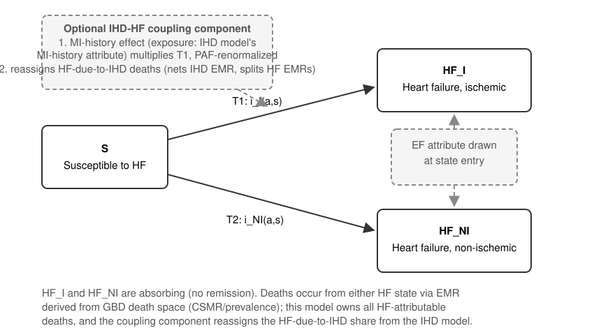

.. _2023_cause_heart_failure:

========================
Heart Failure: GBD 2023
========================

In GBD, heart failure (HF) is an impairment, not a cause. GBD
distributes the nonfatal burden of HF across the causes that produce
it, as severity-graded sequelae of those causes. GBD treats deaths
coded to HF as "garbage codes" and redistributes them to an
underlying cause. This page documents a Vivarium cause model of heart
failure built on GBD 2023 inputs. The model splits the HF envelope
into two states by etiology, ischemic and non-ischemic. It gives each
simulant a continuous ejection fraction (EF) attribute at HF onset.
Observers classify events into HFrEF, HFmrEF, and HFpEF with
configurable cutoffs.

This model succeeds the fused ischemic heart disease and heart failure
model documented at :ref:`2019_cause_ihd`. It keeps the etiology
proportions of that model. It differs in four ways:

1. HF has its own cause model. It does not share a state machine with
   ischemic heart disease (IHD).
2. In a simulation that also models IHD, one optional coupling
   component raises the ischemic HF hazard for simulants with a
   history of myocardial infarction (MI) and removes the
   HF-due-to-IHD deaths from the excess mortality of the IHD model.
   The population-level HF incidence does not change. See `The IHD-HF
   coupling component`_.
3. The excess mortality comes from the etiology-specific HF
   cause-specific mortality rates of the GBD etiology pipeline. It
   does not come from the DisMod excess mortality rate of the HF
   envelope.
4. The EF attribute is new.

.. contents::
   :local:
   :depth: 1

.. list-table:: Abbreviations
   :widths: 15 25 30
   :header-rows: 1

   * - Abbreviation
     - Definition
     - Notes
   * - HF
     - Heart failure
     -
   * - EF / LVEF
     - (Left ventricular) ejection fraction
     - Fraction of blood pumped out of the left ventricle per beat
   * - HFrEF
     - Heart failure with reduced ejection fraction
     - LVEF :math:`\leq` 40%
   * - HFmrEF
     - Heart failure with mildly reduced ejection fraction
     - LVEF 41–49%
   * - HFpEF
     - Heart failure with preserved ejection fraction
     - LVEF :math:`\geq` 50%
   * - IHD
     - Ischemic heart disease
     -
   * - MI / AMI
     - (Acute) myocardial infarction
     -
   * - HHD
     - Hypertensive heart disease
     -
   * - CSMR
     - Cause-specific mortality rate
     -
   * - EMR
     - Excess mortality rate
     -
   * - ME
     - Modelable entity
     - The GBD identifier of a modeled quantity
   * - BoP
     - Burden of proof
     - The GBD meta-regression framework for risk-outcome curves

Disease Overview
----------------

**Heart failure**

Heart failure is a condition in which the heart does not pump enough
blood to meet the needs of the body. In some patients the heart does
not fill with enough blood. In other patients the heart does not
eject blood with enough force. Some patients have both problems.
Heart failure develops over time as the pumping action of the heart
weakens. It can affect one or both sides of the heart. The leading
causes are diseases that damage the heart, including ischemic heart
disease, high blood pressure, and cardiomyopathies. Heart failure is
a chronic and progressive condition. Medication, devices, and
lifestyle change can control the symptoms. Most patients have
repeated hospitalizations and a high mortality rate. [NHLBI-HF]_
[AHA-HF]_

**Ejection-fraction phenotypes**

Clinicians stratify heart failure by left ventricular ejection
fraction (LVEF). The consensus definitions [Bozkurt-2021]_
[ESC-2021]_ distinguish three phenotypes: heart failure with reduced
ejection fraction (HFrEF, LVEF :math:`\leq` 40%), heart failure with
mildly reduced ejection fraction (HFmrEF, LVEF 41–49%), and heart
failure with preserved ejection fraction (HFpEF, LVEF :math:`\geq`
50%). This page calls these three phenotypes the EF classes. The EF
classes differ in etiology and epidemiology:

- HFrEF is more often ischemic in origin (prior MI or coronary
  disease). It is more common in men. Most guideline-directed medical
  therapy was developed for HFrEF.
- HFpEF is more often associated with hypertension, obesity, atrial
  fibrillation, and older age. It is more common in women. Its share
  of incident HF rises with age. In community cohorts, about half of
  incident HF is HFpEF. Its share of hospitalized HF has risen over
  time. [Ho-2016]_ [Gerber-2015]_ [Steinberg-2012]_
- HFmrEF is intermediate on most characteristics. The model keeps it
  as a class so that analysts can vary the cutoffs.

Mortality after an HF diagnosis is high in all three classes. A
meta-analysis of adjusted comparisons found a modestly lower
mortality in HFpEF than in HFrEF [MAGGIC-2012]_. A community cohort
found a smaller difference [Gerber-2015]_.

The EF attribute lets the model represent treatments whose efficacy
differs between HFrEF and HFpEF.

GBD 2023 Modeling Strategy
--------------------------

GBD 2023 Non-Fatal Modeling Strategy
++++++++++++++++++++++++++++++++++++

**Case definition**

Clinicians diagnose heart failure with structured criteria such as
the Framingham criteria [Framingham]_ or the European Society of
Cardiology criteria [Cardiology]_. Since GBD 2016, the GBD case
definition is ACC/AHA Stage C and above. The definition includes
persons who have symptoms now and persons who have a diagnosis but no
symptoms now (for example, persons whose HF is controlled by
treatment). The GBD case definition does not refer to ejection
fraction. The envelope includes HFrEF, HFmrEF, and HFpEF without
distinction.

**Input data**

Literature data, inpatient hospital data, and claims data inform the
HF envelope (ME 2412). Two further data streams inform the etiology
machinery. Person-level vital registration data with causal-chain
codes (United States, Mexico, Brazil, Taiwan, and Colombia) inform,
for each etiology, the fraction of deaths from that underlying cause
that have HF in the causal chain (:math:`\text{PropDeathsWithHF}_{e}`
below). Person-level hospital discharge data from Friuli Venezia
Giulia, Italy, linked to the death records of that region, inform the
excess mortality of HF due to each etiology.

**Etiological fraction estimation**

Four etiologies bypass the proportion framework. GBD models HF due to
Chagas disease, degenerative mitral valve disease, and calcific
aortic valve disease inside each parent cause. GBD sets HF after
acute stroke by a literature assumption that 5% of acute strokes
result in HF. GBD subtracts all four from the envelope before it
estimates and applies the proportions below. The scaled proportions
multiply the HF prevalence that excludes these four etiologies
[GBD-2023-NF]_.

For every other etiology, GBD estimates the prevalence of HF due to
that etiology with the epidemiological identity

.. math::
   \text{Prevalence}_{HF \text{ due to } e} =
   \frac{\text{CSMR}_{HF \text{ due to } e}}{\text{EMR}_{HF \text{ due to } e}}

where the etiology-specific HF CSMR is

.. math::
   \text{CSMR}_{HF \text{ due to } e} =
   \text{CSMR}_{e} \times \text{PropDeathsWithHF}_{e}

:math:`\text{CSMR}_{e}` is the cause-specific mortality of etiology
:math:`e` after CoDCorrect. :math:`\text{PropDeathsWithHF}_{e}` is
the modeled fraction of deaths from etiology :math:`e` in which HF
appears in the causal chain. GBD estimates it in MR-BRT from the
person-level vital registration data. For hypertensive heart disease,
alcoholic cardiomyopathy, and other cardiomyopathy, GBD sets the
proportion to 1, because all deaths from these causes involve HF. GBD
estimates the etiology-specific EMR in MR-BRT from the linked Friuli
Venezia Giulia data. GBD sets the EMR equal across etiologies for
ages under 45.

GBD divides each etiology-specific prevalence by the prevalence of
the HF envelope to give a proportion. GBD aggregates the proportions
to seven mutually exclusive and collectively exhaustive etiology
groupings: coronary artery disease, pressure overload of the left
heart, pressure overload of the right heart, valve diseases, primary
myocardial diseases, toxins, and stress cardiomyopathies. These
death-derived proportions and literature data inform one DisMod-MR
2.1 proportion model per grouping, with country-level SEV covariates.
GBD then scales the DisMod outputs so that they sum to one. The
scaling happens after the DisMod models, not on the raw quotients. In
sub-Saharan Africa, GBD excludes the death-derived proportions and
uses the THESUS-HF study instead [THESUS]_. GBD then splits each
grouping into its sub-causes in proportion.

The seven groupings are the taxonomy of the HF proportion models.
They are not GBD cause-list labels. Coronary artery disease
corresponds to the IHD cause. Pressure overload of the left heart
corresponds to hypertensive heart disease. Pressure overload of the
right heart corresponds to the cardiopulmonary causes. Valve diseases
include rheumatic and non-rheumatic valve disease.

This model aggregates the seven groupings two ways. The coronary
artery disease proportion defines the ischemic state. The other six
groupings together define the non-ischemic state. See `Model
structure`_.

Severity splits and disability weights
++++++++++++++++++++++++++++++++++++++

GBD splits the HF envelope into four severity levels: treated
(controlled or medically managed), mild, moderate, and severe. The
disability weights below are the GBD 2019 values. We believe they
have not changed across recent rounds. See the todo below.

.. todo::
   Check the severity-split proportions and the DW values against the
   GBD 2023 YLD appendix.

.. list-table:: Severity levels for heart failure and associated disability weights
   :widths: 15 25 12
   :header-rows: 1

   * - Severity level
     - Lay description
     - DW (95% CI)
   * - Treated (controlled, medically managed)
     - Has been diagnosed with clinical heart failure, a chronic
       disease that requires medication every day and causes some
       worry but minimal interference with daily activities.
     - 0.049 (0.031–0.072)
   * - Mild
     - Is short of breath and easily tires with moderate physical
       activity, such as walking uphill or more than a quarter-mile on
       level ground. The person feels comfortable at rest or during
       activities requiring less effort.
     - 0.041 (0.026–0.062)
   * - Moderate
     - Is short of breath and easily tires with minimal physical
       activity, such as walking only a short distance. The person
       feels comfortable at rest but avoids moderate activity.
     - 0.072 (0.047–0.103)
   * - Severe
     - Is short of breath and feels tired when at rest. The person
       avoids any physical activity, for fear of worsening the
       breathing problems.
     - 0.179 (0.122–0.251)

GBD defines the severity levels by symptoms, not by EF. The EF
attribute in this model (see `Ejection-fraction attribute`_) is
independent of the severity split. The disability weights do not
depend on EF (see `Assumptions and Limitations`_).

.. todo::
   Find out whether the literature reports a relationship between EF
   and symptom severity.

GBD 2023 Fatal Modeling Strategy
++++++++++++++++++++++++++++++++

In GBD, heart failure is an impairment. When a reporting organization
codes a death to heart failure, GBD redistributes the death to the
underlying etiology as part of garbage-code redistribution
[GBD-2023-CoD]_. CODEm and CoDCorrect produce no estimates of
mortality due to heart failure. The etiology-fraction estimation does
produce the quantity :math:`\text{CSMR}_{HF \text{ due to } e}`
defined above as an intermediate. This model uses that quantity as
the mortality target for its death accounting. See `Excess
mortality`_.

Simulants in this model occupy HF states that have an excess
mortality rate. The simulation therefore produces deaths attributed
to heart failure. GBD has no directly comparable quantity. The
validation must check these deaths with care. See `Validation
Criteria`_.

What GBD does not estimate
++++++++++++++++++++++++++

**No ejection-fraction axis.** No GBD quantity is resolved by
ejection fraction. This applies to the envelope prevalence and
incidence, the etiology proportions, the severity splits, and the
mortality. Every EF-related parameter in this model therefore comes
from the clinical and epidemiologic literature. The model places the
EF attribute downstream of all GBD-derived quantities, so the EF
attribute does not change the GBD calibration.

**The DisMod envelope EMR is not used.** DisMod-MR produces an EMR
for the HF envelope (ME 2412) when it fits the non-fatal model. This
cause model does not use it. The model derives its excess mortality
from the etiology-specific HF CSMR instead. See `Excess mortality`_.

.. todo::
   [VOICE] Give the case against the DisMod envelope EMR: what data
   it is fit from, why its level and age pattern are not credible for
   a clinical HF cohort, and what happened when a consuming project
   used it (HF deaths were inflated, and the project removed the
   EMR).

Cause Hierarchy
+++++++++++++++

.. todo::
   Add ``cause_hierarchy_hf.svg``: the seven GBD proportion groupings
   (plus the four bypass etiologies) feeding the HF envelope, with
   the ischemic and non-ischemic aggregation used by this model
   marked.

Restrictions
++++++++++++

GBD estimates the HF envelope (ME 2412, ``rei_id`` 196) for males and
females across the full GBD age range. The etiology mix varies
strongly with age.

============================  =============================================
Sex                           Both (male and female estimated separately)
Age group start               Early Neonatal (``age_group_id`` 2)
Age group end                 95 plus (``age_group_id`` 235)
Measures published            Prevalence, YLDs
============================  =============================================

Heart failure is an impairment, not a cause. The cause-level YLL-only
and YLD-only restriction flags do not apply. GBD publishes no YLLs for
the impairment. GBD redistributes deaths coded to heart failure to the
underlying cause of death. Heart failure contributes YLDs only, and
GBD attributes those YLDs to the etiologic causes.

Prevalence is non-zero in every age group from birth. In infancy,
congenital heart anomalies dominate the envelope (76% at 1 to 5
months). Ischemic and hypertensive heart disease together account for
55% of the envelope at age 40 to 44 and 65% at age 85 to 89
[GBD-2023-NF]_.

Vivarium Modeling Strategy
--------------------------

Scope
+++++

.. todo::
   [VOICE] Write the scope statement. Points to react to:

   - The model simulates the first onset of clinical heart failure
     and the excess mortality after onset. It does not simulate the
     natural history of HF (severity progression, remission, or
     repeated decompensation).
   - The model splits the envelope by etiology (ischemic and
     non-ischemic) for two reasons. Mortality can differ by etiology
     through the etiology-specific HF CSMR. MI history can act on
     ischemic entry through the optional coupling component.
   - The model assigns a continuous EF attribute at onset. Observers
     classify events into HFrEF, HFmrEF, and HFpEF with configurable
     cutoffs. EF is an attribute, not a state.
   - The model is complete on its own. A simulation that also models
     IHD adds one optional coupling component. The component applies
     the MI-history effect and moves the HF-due-to-IHD deaths out of
     the EMR of the IHD model.
   - Relationship to :ref:`2019_cause_ihd`: this model keeps the
     etiology proportions. It separates HF from the IHD state
     machine, derives the EMR from the etiology-specific HF CSMR
     instead of the envelope EMR, and adds the EF attribute.

Model structure
+++++++++++++++

The cause model has three states: susceptible (``S``), heart failure
of ischemic etiology (``HF_I``), and heart failure of non-ischemic
etiology (``HF_NI``). Both HF states are absorbing. There is no
remission. The two HF states are mutually exclusive. The etiology of
a simulant is fixed at entry.

The model splits the envelope incidence and prevalence from ME 2412
by the GBD etiology proportions. It aggregates the seven etiology
groupings two ways (see `GBD 2023 Non-Fatal Modeling Strategy`_):

.. math::
   \text{prop}_I = \text{propHF}_{CAD}, \qquad
   \text{prop}_{NI} = 1 - \text{propHF}_{CAD}
   = \sum_{e \neq CAD} \text{propHF}_{e}

CAD is the coronary artery disease grouping, which is the IHD share.
The sum runs over the other six groupings: pressure overload of the
left heart, pressure overload of the right heart, valve diseases,
primary myocardial diseases, toxins, and stress cardiomyopathies. The
artifact keeps the per-grouping detail for the mortality accounting
(see `Excess mortality`_). The state machine uses only the two
aggregates.

.. todo::
   The four bypass etiologies (Chagas disease, degenerative mitral
   valve disease, calcific aortic valve disease, and HF after acute
   stroke) sit outside the seven-grouping proportions. Decide whether
   the prevalence and CSMR of the non-ischemic state include them
   (their HF burden lives in the parent-cause models) or whether the
   envelope used here already excludes them. For a high-income
   application, we expect the valve diseases to be the bypass
   etiologies with material burden. That expectation is a judgment,
   not a measurement.

The cause model itself never refers to MI history. In a simulation
that also models IHD, MI history acts on the ``HF_I`` incidence-rate
pipeline through the MI-history effect of the coupling component (see
`Effect of MI history on ischemic HF incidence`_). The PAF
renormalization of that effect holds the population-level ``HF_I``
incidence at the GBD-derived split. The population-level calibration
is therefore the same with and without the component.

Running standalone or alongside an IHD model
++++++++++++++++++++++++++++++++++++++++++++

This cause model is complete on its own. Its states, transitions, and
data do not require an IHD model. When it runs standalone, the model
reproduces the population-level behavior of the GBD 2019 model
(:ref:`2019_cause_ihd`), in which simulants entered HF from IHD at
the population rate regardless of MI history.

A simulation that also models IHD adds one thing: the optional
coupling component (see `The IHD-HF coupling component`_). The
component makes two adjustments.

1. **The MI-history effect.** MI history is an individual-level
   determinant of ischemic HF. It enters this model the same way a
   risk factor does. A modifier multiplies the ``HF_I`` incidence-rate
   pipeline for exposed simulants. The exposure is the MI-history
   attribute of the IHD model. The modifier renormalizes so that the
   population-level rate does not change. Because the effect is an
   ordinary pipeline modifier, a model specification that omits the
   component gets the standalone behavior. The cause model itself has
   no configuration for this.

2. **The death reassignment.** This model always owns the
   HF-attributable deaths across the etiology groupings. Its CSMR is
   :math:`\sum_e \text{CSMR}_{HF \text{ due to } e}`. The standard
   Vivarium accounting deducts this CSMR from the mortality of the
   unmodeled causes. GBD assigns HF deaths to their underlying causes.
   An IHD model built from GBD data therefore carries the
   HF-due-to-IHD deaths a second time. The coupling component
   subtracts them from the chronic and post-MI excess-mortality
   pipeline of the IHD model at run time. At the same time it splits
   the shared excess mortality of the HF states by etiology, so that
   ``HF_I`` emits exactly the reassigned deaths. See `Reassigning
   HF-due-to-IHD deaths`_. The validation invariant is: the
   IHD-attributable deaths summed across the two models (the IHD
   model states plus ``HF_I``) match the GBD IHD CSMR. See
   `Validation Criteria`_.

All of these modifiers live in one component. A model specification
therefore adopts both adjustments or neither. One misconfiguration
remains possible: a specification that includes both cause models but
no coupling component. That specification counts the HF-due-to-IHD
deaths twice. The death-accounting invariant in `Validation
Criteria`_ detects it.

Cause Model Diagram
+++++++++++++++++++

State and Transition Data Tables
++++++++++++++++++++++++++++++++

Definitions
"""""""""""

.. list-table:: State Definitions
   :widths: 1 10 20
   :header-rows: 1

   * - State
     - State Name
     - Definition
   * - S
     - **S**\ usceptible
     - Simulant without clinical heart failure
   * - HF_I
     - **H**\ eart **F**\ ailure, **I**\ schemic
     - Simulant with clinical heart failure attributed to ischemic
       heart disease (GBD proportion grouping: coronary artery
       disease)
   * - HF_NI
     - **H**\ eart **F**\ ailure, **N**\ on-\ **I**\ schemic
     - Simulant with clinical heart failure attributed to any non-IHD
       etiology (aggregate of the six non-CAD proportion groupings)

States Data
"""""""""""

.. list-table:: State Data
   :widths: 5 10 20 20
   :header-rows: 1

   * - State
     - Measure
     - Value
     - Notes
   * - All
     - cause-specific mortality rate
     - :math:`\sum_{e} \text{CSMR}_{HF \text{ due to } e}` summed over
       the etiology groupings, in every configuration
     - Mortality target. See `Excess mortality`_. When an IHD model
       runs alongside, the coupling component removes the ischemic
       term from the EMR pipeline of that model (see `The IHD-HF
       coupling component`_). The model derives the state EMRs from
       this quantity, so prev × EMR equals this CSMR by construction.
       Literature survival is a validation target, not an input.
   * - S
     - prevalence
     - :math:`1 - \text{prevalence\_m2412}`
     -
   * - HF_I
     - prevalence
     - :math:`\text{prevalence\_m2412} \times \text{prop}_I`
     -
   * - HF_I
     - excess mortality rate
     - :math:`\text{EMR}_{HF}` (shared, prevalence-weighted). See
       `Excess mortality`_
     - The coupling component replaces this with the
       etiology-specific EMR (see `Reassigning HF-due-to-IHD
       deaths`_)
   * - HF_I
     - disability weight
     - prevalence-weighted blend of the DWs of the HF-due-to-IHD
       severity sequelae
     - Same method as :ref:`2019_cause_ihd`
   * - HF_NI
     - prevalence
     - :math:`\text{prevalence\_m2412} \times \text{prop}_{NI}`
     -
   * - HF_NI
     - excess mortality rate
     - :math:`\text{EMR}_{HF}` (shared, prevalence-weighted). See
       `Excess mortality`_
     - The coupling component replaces this with the
       etiology-specific EMR (see `Reassigning HF-due-to-IHD
       deaths`_)
   * - HF_NI
     - disability weight
     - prevalence-weighted blend of the DWs of the non-IHD HF severity
       sequelae
     -

Transition Data
"""""""""""""""

.. list-table:: Transition Data
   :widths: 5 5 5 25 20
   :header-rows: 1

   * - Transition
     - Source
     - Sink
     - Value
     - Notes
   * - T1
     - S
     - HF_I
     - :math:`i_I(a,s) = \frac{\text{incidence\_m2412} \times
       \text{prop}_I}{1 - \text{prevalence\_m2412}}`
     - Rate per susceptible simulant. In a simulation that also
       models IHD, the optional MI-history effect modifies this
       pipeline. See `Effect of MI history on ischemic HF incidence`_
   * - T2
     - S
     - HF_NI
     - :math:`i_{NI}(a,s) = \frac{\text{incidence\_m2412} \times
       \text{prop}_{NI}}{1 - \text{prevalence\_m2412}}`
     - Rate per susceptible simulant. Not conditioned on MI history

.. todo::
   Confirm the denominator convention against the rate-rescaling
   behavior of the consuming framework (population-rate input or
   susceptible-rate input) before implementation.

Data Sources
""""""""""""

.. list-table:: Data Sources and Definitions
   :widths: 12 12 25 25
   :header-rows: 1

   * - Variable
     - Source
     - Description
     - Notes
   * - prevalence_m2412
     - como
     - Prevalence of the HF envelope
     -
   * - incidence_m2412
     - dismod-mr, como
     - Incidence of the HF envelope
     -
   * - propHF_e (seven groupings)
     - CVD team / GBD etiology proportion models
     - Proportion of HF attributable to grouping :math:`e`, by age,
       sex, and location, in the seven-grouping proportion taxonomy
     - GBD 2023 regeneration of the proportions file used in
       :ref:`2019_cause_ihd`
   * - CSMR_e
     - CoDCorrect
     - Cause-specific mortality of etiology :math:`e` (after
       CoDCorrect)
     -
   * - :math:`\text{CSMR}_{HF \text{ due to } e}`
     - CVD team (= CSMR_e :math:`\times` PropDeathsWithHF_e)
     - HF-attributable death rate per grouping
     - Drives the model CSMR and every derived EMR. See `Excess
       mortality`_
   * - PropDeathsWithHF_e
     - CVD team (MR-BRT)
     - Fraction of etiology-:math:`e` deaths with HF in the causal
       chain
     - Equals 1 for HHD and the cardiomyopathies
   * - HF severity sequela prevalences and DWs
     - como, YLD appendix
     - For the per-state blended disability weights
     -
   * - :math:`RR_{MI}`
     - literature
     - Hazard ratio for incident HF given prior MI
     - See `Effect of MI history on ischemic HF incidence`_
   * - EF class allocation parameters
     - literature
     - Multinomial model of incident EF class
     - See `Ejection-fraction attribute`_
   * - Within-class EF distributions
     - literature (registries)
     - Continuous EF draw given class
     - See `Ejection-fraction attribute`_
   * - EF mortality contrast :math:`g(\text{EF})`
     - literature
     - EF-differential modifier on the state EMRs
     - See `Excess mortality`_

The IHD-HF coupling component
+++++++++++++++++++++++++++++

Everything a simulation must do differently because it models both
IHD and HF lives in this one optional component. The component makes
the two adjustments below through pipeline modifiers. Neither
adjustment changes the states, transitions, or artifact data of
either cause model. The same artifact therefore runs standalone and
coupled.

Effect of MI history on ischemic HF incidence
"""""""""""""""""""""""""""""""""""""""""""""

The model treats MI history as a dichotomous risk factor for ischemic
heart failure. This modifier is directly analogous to the categorical
risk effects documented elsewhere in this repository. It is
risk-effect machinery, not cause-model machinery. The component reads
the MI-history attribute :math:`x \in \{0, 1\}` of the IHD model and
registers a multiplicative modifier on the ``HF_I`` incidence-rate
pipeline:

.. math::
   \lambda_I(a, s, x) = i_I(a,s) \cdot
   (1 - \text{PAF}_{MI}(a,s)) \cdot RR_{MI}^{x},
   \qquad
   \text{PAF}_{MI}(a,s) =
   \frac{p_{MI}(a,s) \, (RR_{MI} - 1)}{p_{MI}(a,s) \, (RR_{MI} - 1) + 1}

:math:`RR_{MI}` is the literature hazard ratio for incident HF given
prior MI. :math:`p_{MI}(a,s)` is the prevalence of MI history among
HF-susceptible simulants. This is the standard risk-deleted-rate
construction that every risk effect uses. The expected
population-level hazard equals :math:`i_I(a,s)`. The population-level
``HF_I`` incidence, and everything GBD-calibrated downstream of it,
is the same with and without the component.

A pipeline modifier has three advantages over cause-model structure.
The cause model stays a plain two-transition disease model. The
effect reuses the existing risk-effect machinery of the framework,
including its PAF renormalization and its mediation adjustments (see
`Risk-effects interface`_). The standalone configuration needs no
special case. It is the model specification without this component.

.. list-table:: MI-history effect parameters
   :widths: 10 15 25 25
   :header-rows: 1

   * - Parameter
     - Value (uncertainty)
     - Source
     - Notes
   * - :math:`RR_{MI}`
     - TBD
     - TBD. Candidate sources: post-MI registry cohorts
       [Jernberg-2015]_, trial placebo arms [VALIANT]_, community
       cohorts
     - Extraction pending. Decide between a constant value and a
       value stratified by age, sex, or time since MI

.. todo::
   [LIT] Extract :math:`RR_{MI}` with uncertainty. Decide whether the
   literature supports stratification by time since MI. We expect the
   risk of HF to be highest in the first months after an MI. If the
   model uses a constant, record the limitation in `Assumptions and
   Limitations`_.

.. todo::
   Decide where :math:`p_{MI}(a,s)`, and therefore
   :math:`\text{PAF}_{MI}`, comes from. The standard risk effects of
   the framework read a build-time PAF from the artifact. Here the
   artifact can supply it from the GBD post-MI prevalence. A PAF
   computed from live state occupancy stays self-consistent under an
   intervention, but it needs a small framework extension. Make this
   choice together with the denominator choice in the death
   reassignment below.

Reassigning HF-due-to-IHD deaths
""""""""""""""""""""""""""""""""

This model always owns the HF-attributable deaths across the etiology
groupings (see `Running standalone or alongside an IHD model`_). GBD
assigns the HF-due-to-IHD deaths to the IHD cause. An IHD model with
an EMR derived from GBD data therefore carries those deaths a second
time. The coupling component moves those deaths from the IHD model to
the ``HF_I`` state with two modifiers that act as one operation.

**Netting.** A subtractive modifier on the chronic and post-MI
excess-mortality pipeline of the IHD model:

.. math::
   \text{EMR}^{net}_{chronic}(a,s) = \max\!\left(0, \;
   \text{EMR}_{chronic}(a,s) -
   \frac{\text{CSMR}_{HF \text{ due to } IHD}(a,s)}
        {\text{prevalence}_{chronic}(a,s)}\right)

**Etiology split of the HF excess mortality.** Without the coupling
component, both HF states carry the shared prevalence-weighted EMR
(see `Excess mortality`_). The coupling component replaces it with
the etiology-specific pair

.. math::
   \text{EMR}_{HF\_I}(a,s) =
   \frac{\text{CSMR}_{HF \text{ due to } IHD}(a,s)}
        {\text{prevalence}_{HF\_I}(a,s)},
   \qquad
   \text{EMR}_{HF\_NI}(a,s) =
   \frac{\sum_{e \neq CAD} \text{CSMR}_{HF \text{ due to } e}(a,s)}
        {\text{prevalence}_{HF\_NI}(a,s)}

The prevalence-weighted combination of the pair equals the shared
EMR. The total number of HF deaths does not change. Only their
attribution moves.

Together the two modifiers close the death accounting exactly.
``HF_I`` emits :math:`\text{prevalence}_{HF\_I} \times
\text{EMR}_{HF\_I} = \text{CSMR}_{HF \text{ due to } IHD}`. These are
exactly the deaths that the netting removed from the IHD model. There
is no reconciliation residual. All inputs are artifact data, so the
modifiers are deterministic given the artifact. Unlike the MI-history
effect, this operation changes the population-level mortality of each
cause model. It moves deaths by design. The invariant it preserves is
the cross-model one: the IHD-attributable deaths summed across the
two models match the GBD IHD CSMR.

The reassignment lives in the coupling component, not in the data
derivation of either model. This keeps the artifact independent of
the model specification. The same artifact data runs standalone or
coupled. It also keeps the coupling all-or-nothing. A specification
adopts the incidence effect and the death reassignment together or
omits both.

.. todo::
   The subtraction can make :math:`\text{EMR}^{net}_{chronic}`
   negative in strata where the HF-due-to-IHD deaths exceed the
   chronic residual EMR. We expect this at the oldest ages, where
   most IHD deaths involve HF. The floor at zero moves that shortfall
   to the mortality of the ``HF_I`` state without a warning. Add a
   validation check that reports how much death mass reaches the
   floor. If the amount is material, revisit the residual-EMR
   derivation of the IHD model.

.. todo::
   Choose the prevalence denominator: the artifact chronic-IHD
   prevalence (static, which matches the derivation of the residual
   EMR) or the live state occupancy. We recommend static for
   consistency. This is the same static-or-live choice as for
   :math:`\text{PAF}_{MI}` above. Make the two choices together.

Ejection-fraction attribute
+++++++++++++++++++++++++++

EF is a continuous attribute. The model assigns it once, at entry
into either HF state, and at initialization for prevalent HF. The
assignment has two stages:

1. **Class allocation.** The model draws an EF class :math:`c \in
   \{\text{HFrEF}, \text{HFmrEF}, \text{HFpEF}\}` from a multinomial
   logistic model. The model conditions on etiology (the state
   entered), age, sex, and the metabolic covariates available in the
   simulation (for example, body mass index, fasting plasma glucose,
   and systolic blood pressure). The covariate coefficients come from
   pooled community cohorts [Ho-2016]_. The class intercepts are
   calibrated so that the incident class shares by age and sex match
   cohort and registry targets [Gerber-2015]_ [Steinberg-2012]_.
2. **Within-class EF draw.** Given the class, the model draws a
   continuous EF value from a within-class distribution derived from
   registry data (for example, a truncated distribution on the EF
   band of the class, with a shape fit to the EF histograms of a
   hospitalized-HF registry [Steinberg-2012]_).

For prevalent HF at initialization, the model uses the EF
distribution of the prevalent population, not of incident cases.
Differential survival shifts the prevalent mix.

EF stays fixed for the rest of the life of the simulant. There is no
EF trajectory and no improvement after treatment (see `Assumptions
and Limitations`_). Observers classify simulants into HFrEF, HFmrEF,
and HFpEF at analysis time with configurable cutoffs (default 40 and
50). Endpoint definitions and cutoff sensitivity analyses therefore
do not require a new simulation run.

The allocation stage produces class-specific risk gradients. The
class probabilities depend on the metabolic covariates. A covariate
that raises total HF incidence (through the risk effects on T1 and
T2) and also tilts the allocation toward HFpEF produces a steeper
population-level gradient for HFpEF than for HFrEF. The all-HF
gradient does not change (see `Risk-effects interface`_).

.. list-table:: EF attribute parameters (extraction pending)
   :widths: 15 20 25 25
   :header-rows: 1

   * - Parameter block
     - Form
     - Source
     - Notes
   * - Incident class allocation
     - multinomial logistic in etiology, age, sex, BMI, FPG, SBP
     - [Ho-2016]_ (pooled FHS / CHS / PREVEND / MESA). Class shares
       from [Gerber-2015]_
     - TBD
   * - Within-class EF distributions
     - truncated distributions per class band
     - [Steinberg-2012]_ or a comparable registry
     - TBD
   * - Prevalent-population EF distribution
     - as above, prevalent mix
     - registry / community cohort
     - TBD

.. todo::
   [LIT] Extract all three parameter blocks with uncertainty. Atrial
   fibrillation is a strong HFpEF predictor, and it is not in the
   covariate set of the consuming simulation. The age and sex terms
   absorb its contribution. Record this under `Assumptions and
   Limitations`_.

Excess mortality
++++++++++++++++

Neither the DisMod envelope EMR nor literature survival supplies the
excess mortality in this model (see `What GBD does not estimate`_ for
the case against the envelope EMR). The model derives the state EMRs
from the etiology-specific HF CSMR with the same identity that GBD
uses, :math:`\text{prevalence} = \text{CSMR} / \text{EMR}`. The EMR
of each state is its HF-attributable CSMR divided by its prevalence.

Without the coupling component, both HF states carry the shared
prevalence-weighted EMR

.. math::
   \text{EMR}_{HF}(a,s) =
   \frac{\sum_e \text{CSMR}_{HF \text{ due to } e}(a,s)}
        {\text{prevalence\_m2412}(a,s)}

The total number of HF deaths then equals
:math:`\sum_e \text{CSMR}_{HF \text{ due to } e}`, which is the CSMR
of the model, with no reconciliation residual. With the coupling
component, the etiology-specific pair replaces the shared EMR (see
`Reassigning HF-due-to-IHD deaths`_). The split preserves the
prevalence-weighted total. The identity holds in every configuration.

Literature survival after diagnosis, from community HF cohorts
[Gerber-2015]_ and the MAGGIC meta-analysis [MAGGIC-2012]_, is
therefore free to serve as an external validation target for the
derived EMRs. It is not a model input. See `Validation Criteria`_.

.. todo::
   Confirm the extraction path for
   :math:`\text{CSMR}_{HF \text{ due to } e}`. It is an intermediate
   of the etiology-fraction pipeline (:math:`\text{CSMR}_e` after
   CoDCorrect times :math:`\text{PropDeathsWithHF}_e`). We expect it
   to arrive as a handoff from the CVD modeling team, like the
   proportions, rather than from a central-machinery pull. Also
   decide how the HF deaths of the four bypass etiologies (in
   particular degenerative mitral valve disease and calcific aortic
   valve disease) enter the sum. See the todo in `Model structure`_.

.. todo::
   The derived EMRs inherit the GBD assumptions upstream of them
   through the proportions: the EMR structure from the linked Friuli
   Venezia Giulia data and the equal EMR across etiologies under age
   45. Keep these in `Assumptions and Limitations`_ and check them
   against the survival validation targets.

The EF class modifies the state EMR multiplicatively through a
function :math:`g(\text{EF})` (or through class-based hazard ratios).
The model renormalizes the modifier within each state and each age
and sex stratum, so that the etiology-level EMR, and therefore the
CSMR, does not change:

.. math::
   \text{EMR}(a, s, \text{state}, \text{EF}) =
   \text{EMR}_{\text{state}}(a,s) \cdot
   \frac{g(\text{EF})}{E[\,g(\text{EF}) \mid \text{state}, a, s\,]}

.. list-table:: Mortality parameters
   :widths: 15 20 25 25
   :header-rows: 1

   * - Parameter
     - Form
     - Source
     - Notes
   * - :math:`\text{CSMR}_{HF \text{ due to } e}`
     - by age and sex, per grouping
     - GBD etiology-fraction pipeline (CVD team)
     - Drives the model CSMR and every derived EMR
   * - EF mortality contrast :math:`g(\text{EF})`
     - class HRs or a smooth function of EF
     - [MAGGIC-2012]_, [Gerber-2015]_
     - Renormalized to preserve the etiology-level EMR. Extraction
       pending
   * - Post-diagnosis survival targets
     - survival curves by etiology and EF class
     - [MAGGIC-2012]_, [Gerber-2015]_
     - Validation targets, not inputs

.. todo::
   [LIT] Extract :math:`g(\text{EF})` with uncertainty. The MAGGIC
   adjusted comparison (lower mortality in HFpEF) and the community
   cohort comparison (near-equal mortality) disagree. Decide which
   one the model carries.

Risk-effects interface
++++++++++++++++++++++

Risk factors act on the total HF incidence, which is the sum of T1
and T2 before the etiology split. They act through the same
risk-effect components that the consuming simulation uses elsewhere
(see the SBP, BMI, and FPG risk-effects documentation). The etiology
split and the EF allocation sit downstream of the risk effects. This
has two consequences:

- The all-HF exposure-incidence relationship (for example, a
  burden-of-proof curve fit to all-HF outcomes) is recovered exactly
  as the population-level relationship across etiology and EF class.
  This is a required validation invariant.
- Class-specific gradients emerge from the allocation stage (see
  `Ejection-fraction attribute`_). The model does not need
  class-specific absolute hazard curves, which are scarce in the
  literature.

**Design note: total effects and direct effects with the MI-history
effect.** An all-HF risk-outcome curve estimated from cohort data is
a total effect. It includes the pathway through an interim MI. When
the coupling component is included, that pathway also exists in the
simulation structure (risk to MI to elevated ``HF_I`` hazard). A
simulation that applies the full total-effect curve as a direct
effect then counts the mediated share twice. Both pieces are ordinary
risk-effect components, so the existing mediated-risk-effect
machinery of the framework can remove the mediated share.

.. todo::
   [VOICE] Record the mediation decision. The options are: remove the
   MI-mediated share from the direct risk-to-HF effect with the
   mediated-risk-effect machinery of the consuming framework, accept
   the double count as small (quantify it first), or ask the curve
   authors whether they adjusted for interim MI. The decision
   interacts with the magnitude of :math:`RR_{MI}`.

Assumptions and Limitations
+++++++++++++++++++++++++++

.. todo::
   [VOICE] Edit, cut, and re-rank this candidate list.

#. **No remission or recovery.** The HF states are absorbing. The GBD
   DisMod model permits remission. Clinically, some patients (in
   particular patients with improved EF) leave the Stage C symptom
   level. We expect the model to overstate prevalent person-time at
   older ages by a small amount.
#. **EF is fixed at onset.** There is no EF trajectory, no
   deterioration, and no improvement after treatment. The model does
   not represent a change of class over time (HF with improved EF).
   The classification reflects EF at diagnosis. This matches how
   trials usually adjudicate endpoints.
#. **One incident event.** There are no repeated HF hospitalizations.
   The model supports time-to-first-event endpoints. Total
   hospitalization and win-ratio analyses need a hospitalization
   process on top of the prevalent state.
#. **Disability weights do not depend on EF and blend the severity
   levels.** The GBD severity splits are symptom-based. The model
   does not vary the DW by EF class.
#. **Etiology proportions estimated in prevalence space are applied
   to incidence.** The GBD etiology fractions come from prevalence
   (CSMR divided by EMR). Applying them to incident events assumes
   that the incident and prevalent etiology mixes agree at the age
   and sex resolution of the proportions.
#. **Non-ischemic entry is independent of MI history.** The six
   non-IHD groupings form one state with one EMR.
#. **The MI-history hazard ratio is constant** unless the extraction
   supports stratification. A constant ignores the higher HF risk in
   the first months after an MI.
#. **Atrial fibrillation is absent from the EF allocation
   covariates.** The consuming simulation does not model it. The age
   and sex terms absorb its HFpEF association.
#. **The derived EMRs inherit the etiology-fraction assumptions of
   GBD.** The EMR structure comes from linked data for one Italian
   region (Friuli Venezia Giulia). GBD sets the EMR equal across
   etiologies under age 45. Like every GBD quantity on this page, the
   EMRs are general-population values. A consuming simulation may
   apply them to a risk-enriched cohort.
#. **HF due to the four bypass etiologies** (Chagas disease,
   degenerative mitral valve disease, calcific aortic valve disease,
   and HF after acute stroke) sits outside the seven-grouping
   proportions. Their treatment in the envelope and CSMR of this
   model is an open decision (see the todo in `Model structure`_).
#. **Etiology is a label fixed at entry.** The model does not
   re-adjudicate it. A simulant who enters ``HF_NI`` and later has an
   MI stays in ``HF_NI``.

Outputs and post-processing
+++++++++++++++++++++++++++

Observers record each HF event with its state (etiology), the
continuous EF value, and the event time. Analysts apply the EF
classification (HFrEF, HFmrEF, HFpEF) at analysis time with
configurable cutoffs. One simulation run therefore supports
EF-agnostic endpoints, class-restricted endpoints (for example,
HFpEF-only hospitalization), and cutoff sensitivity analyses. Unlike
the GBD 2019 model (:ref:`2019_cause_ihd`), this model plans no
post-processing split of the non-ischemic state into sub-etiologies.
The per-grouping detail exists in the artifact if a consuming project
needs it.

Validation Criteria
+++++++++++++++++++

The primary validation is a large baseline simulation of one location
(the United States of America), compared with the GBD estimates by
age and sex. The GBD round for the comparison is GBD 2025. We expect
GBD 2025 to enforce age-period-cohort consistency of the non-fatal
cause models more strictly than earlier rounds. The comparison
therefore covers a 20-year horizon, with one comparison at each of
2005, 2010, 2015, 2020, and 2025.

.. todo::
   This page names GBD 2023 as the input round. If the artifact is
   rebuilt from GBD 2025, rename the page and update the data
   sources.

**Primary criteria (GBD comparison, by age and sex, at each
comparison year)**

- Incidence: the simulated all-HF incidence rate matches the GBD
  incidence of the HF envelope.
- Prevalence: the simulated all-HF prevalence matches the GBD
  prevalence of the HF envelope.
- Excess mortality and case fatality: the simulated excess mortality
  rate of the HF states matches the GBD excess mortality rate (the
  etiology-specific EMR that GBD uses as an input, or the envelope
  EMR that GBD produces as an output). The simulated case fatality
  after incident HF matches the case fatality that the GBD inputs
  imply.
- Etiology split: the simulated ``HF_I`` share of incidence and
  prevalence matches :math:`\text{prop}_I`.
- Death accounting (simulations that also model IHD): the
  IHD-attributable deaths summed across the two models (the IHD model
  states plus ``HF_I``) match the GBD IHD CSMR. No HF-due-to-IHD
  death is counted twice. The all-cause mortality rate stays
  calibrated.

**Secondary criteria (internal invariants)**

- Risk-gradient invariant: the population-level all-HF
  exposure-incidence relationship recovers the input curve after the
  etiology and EF layers.
- MI-history effect: the population-level ``HF_I`` incidence is the
  same with and without the coupling component.

**External validation (literature targets, not inputs)**

- EF class shares: the incident HFpEF, HFmrEF, and HFrEF shares by
  age and sex fall within the ranges of the cohort and registry
  sources [Ho-2016]_ [Gerber-2015]_ [Steinberg-2012]_.
- MI-history effect: the cumulative incidence of HF among post-MI
  simulants matches the registry sources [Jernberg-2015]_ [VALIANT]_.
- Survival: the derived EMRs imply a survival after diagnosis, by
  etiology and EF class, that is consistent with [MAGGIC-2012]_ and
  [Gerber-2015]_.

.. todo::
   Candidate additions to the validation plan, for review:

   - A dynamic consistency check. Initialize the simulation from the
     GBD 2005 prevalence and run it to 2025 with year-specific GBD
     incidence, EMR, and all-cause mortality. Compare the simulated
     prevalence at each later comparison year with the GBD prevalence
     for that year. The difference measures the age-period-cohort
     inconsistency of the GBD inputs. Also re-initialize at each
     comparison year, to separate level errors from drift.
   - A birth-cohort trace. Follow one or more birth cohorts across
     the 20 years and compare their age-specific prevalence with the
     GBD cells at the same age and year.
   - The GBD identity check. Report the ratio of the derived state
     EMR to the GBD etiology-specific EMR. GBD scales the DisMod
     proportions to sum to one after the identity, so we expect the
     ratio to differ from one by the scaling factor.
   - Mortality shares. Report the HF-attributable deaths as a share
     of all deaths and of IHD deaths, and compare with
     :math:`\text{PropDeathsWithHF}_{e}`.
   - Disability. Compare the simulated YLDs per prevalent case with
     the GBD YLDs of the HF impairment.
   - Numerical checks. Report the simulant count per age, sex, and
     year cell, the sensitivity to the time step, and the draws
     covered.
   - Boundary age groups. Check the youngest and the oldest age group
     separately. The envelope has non-zero prevalence from birth, and
     the oldest group is where we expect the netting floor to bind.
   - Uncertainty. Run the comparison across draws and report the
     coverage of the GBD uncertainty intervals.

References
----------

.. [NHLBI-HF] Heart Failure. National Heart, Lung, and Blood
   Institute, U.S. Department of Health and Human Services.
   https://www.nhlbi.nih.gov/health/heart-failure

.. [AHA-HF] What is Heart Failure? American Heart Association.
   https://www.heart.org/en/health-topics/heart-failure/what-is-heart-failure

.. [Bozkurt-2021] Bozkurt B, Coats AJS, Tsutsui H, et al. Universal
   definition and classification of heart failure. J Card Fail.
   2021;27(4):387-413.

.. [ESC-2021] McDonagh TA, Metra M, Adamo M, et al. 2021 ESC
   Guidelines for the diagnosis and treatment of acute and chronic
   heart failure. Eur Heart J. 2021;42(36):3599-3726.

.. [Framingham] McKee PA, Castelli WP, McNamara PM, Kannel WB. The
   natural history of congestive heart failure: the Framingham study.
   N Engl J Med. 1971;285:1441-1446.

.. [Cardiology] Ponikowski P, et al. 2016 ESC Guidelines for the
   diagnosis and treatment of acute and chronic heart failure. Eur
   Heart J. 2016;37(27):2129-2200.

.. [Ho-2016] Ho JE, Enserro D, Brouwers FP, et al. Predicting heart
   failure with preserved and reduced ejection fraction: the
   international collaboration on heart failure subtypes. Circ Heart
   Fail. 2016;9(6):e003116.

.. [Gerber-2015] Gerber Y, Weston SA, Redfield MM, et al. A
   contemporary appraisal of the heart failure epidemic in Olmsted
   County, Minnesota, 2000 to 2010. JAMA Intern Med.
   2015;175(6):996-1004.

.. [Steinberg-2012] Steinberg BA, Zhao X, Heidenreich PA, et al.
   Trends in patients hospitalized with heart failure and preserved
   left ventricular ejection fraction: prevalence, therapies, and
   outcomes. Circulation. 2012;126(1):65-75.

.. [MAGGIC-2012] Meta-analysis Global Group in Chronic Heart Failure
   (MAGGIC). The survival of patients with heart failure with
   preserved or reduced left ventricular ejection fraction: an
   individual patient data meta-analysis. Eur Heart J.
   2012;33(14):1750-1757.

.. [Jernberg-2015] Jernberg T, Hasvold P, Henriksson M, Hjelm H,
   Thuresson M, Janzon M. Cardiovascular risk in post-myocardial
   infarction patients: nationwide real world data demonstrate the
   importance of a long-term perspective. Eur Heart J.
   2015;36(19):1163-1170.

.. [VALIANT] Velazquez EJ, Francis GS, Armstrong PW, et al. An
   international perspective on heart failure and left ventricular
   systolic dysfunction complicating myocardial infarction: the
   VALIANT registry. Eur Heart J. 2004;25(21):1911-1919.

.. [THESUS] Damasceno A, Mayosi BM, Sani M, et al. The causes,
   treatment, and outcome of acute heart failure in 1006 Africans
   from 9 countries: results of the sub-Saharan Africa survey of
   heart failure. Arch Intern Med. 2012;172(18):1386-1394.

.. [GBD-2023-NF] GBD 2023 Diseases, Injuries, and Risk Factors
   Collaborators. Burden of 375 diseases and injuries,
   risk-attributable burden of 88 risk factors, and healthy life
   expectancy in 204 countries and territories, including 660
   subnational locations, 1990-2023: a systematic analysis for the
   Global Burden of Disease Study 2023. Lancet. 2025; published online
   Oct 12. doi:10.1016/S0140-6736(25)01637-X. Supplementary appendix 1,
   "Heart failure impairment," pp. 645-660 (case definition, p. 648).

.. [GBD-2023-CoD] GBD 2023 Causes of Death Collaborators. Global burden
   of 292 causes of death in 204 countries and territories and 660
   subnational locations, 1990-2023: a systematic analysis for the
   Global Burden of Disease Study 2023. Lancet. 2025; published online
   Oct 12. doi:10.1016/S0140-6736(25)01917-8. Supplementary appendix 1,
   §3.7 Redistribution of garbage codes, pp. 20-21.
