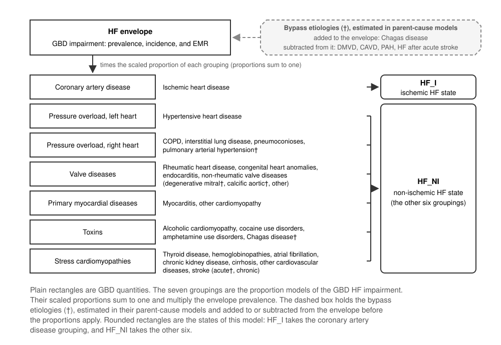
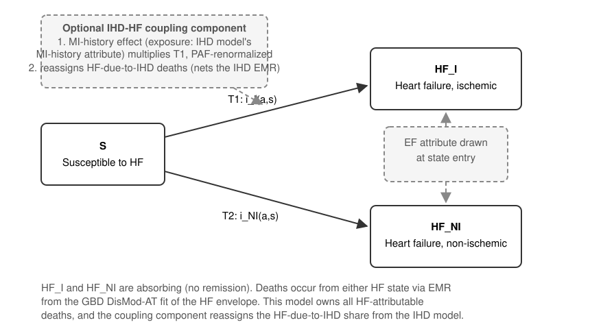

.. _2025_cause_heart_failure:

========================
Heart Failure: GBD 2025
========================

This page documents a Vivarium cause model for heart
failure (HF) built on GBD 2025 inputs. The model splits the HF envelope
into ischemic and non-ischemic HF. It gives each
simulant a continuous ejection fraction (EF) attribute at HF onset.

This model is a successor to the ischemic-heart-disease-and-heart-failure
model documented at :ref:`2019_cause_ihd` and incorporates experience from a
simulation we did for a CSU client in 2026 that we did not document in this repo
for reasons of confidentiality. This model differs from past approaches in three ways:

1. HF has its own cause model. It does not share a state machine with
   ischemic heart disease (IHD).
2. In a simulation that also models IHD, it uses a "coupling
   component" pattern to increase the ischemic HF hazard for simulants with a
   history of myocardial infarction (MI) and removes the
   HF-due-to-IHD deaths from the excess mortality of the IHD model (a pattern analogous to the
   approach we use to match all-cause mortality when a model with cause-specific mortality
   is included in a sim).
3. The EF attribute is new.

.. contents::
   :local:
   :depth: 1

.. list-table:: Abbreviations
   :widths: 15 25 30
   :header-rows: 1

   * - Abbreviation
     - Definition
     - Notes
   * - HF
     - Heart failure
     -
   * - EF / LVEF
     - (Left ventricular) ejection fraction
     - Fraction of blood pumped out of the left ventricle per beat
   * - HFrEF
     - Heart failure with reduced ejection fraction
     - LVEF :math:`\leq` 40%
   * - HFmrEF
     - Heart failure with mildly reduced ejection fraction
     - LVEF 41–49%
   * - HFpEF
     - Heart failure with preserved ejection fraction
     - LVEF :math:`\geq` 50%
   * - IHD
     - Ischemic heart disease
     -
   * - MI / AMI
     - (Acute) myocardial infarction
     -
   * - HHD
     - Hypertensive heart disease
     -
   * - CSMR
     - Cause-specific mortality rate
     -
   * - EMR
     - Excess mortality rate
     -
   * - ME
     - Modelable entity
     - The GBD identifier of a modeled quantity
   * - DisMod-AT
     - DisMod age-time
     - The GBD 2025 non-fatal estimation tool
   * - BoP
     - Burden of proof
     - The GBD meta-regression framework for risk-outcome curves

Disease Overview
----------------

**Heart failure**

Heart failure is a condition in which the heart does not pump enough
blood to meet the needs of the body. In some patients the heart does
not fill with enough blood. In other patients the heart does not
eject blood with enough force. Some patients have both problems.
Heart failure can develop suddenly or over time as the heart gets
weaker. It can affect one or both sides of the heart. [NHLBI-HF]_
[AHA-HF]_ Heart failure is a clinical syndrome with many underlying
causes, not a single disease [Bozkurt-2021]_.

**Ejection-fraction phenotypes**

Clinicians stratify heart failure by left ventricular ejection
fraction (LVEF). The consensus definitions [Bozkurt-2021]_
[ESC-2021]_ distinguish three EF classes: heart failure with reduced
ejection fraction (HFrEF, LVEF :math:`\leq` 40%), heart failure with
mildly reduced ejection fraction (HFmrEF, LVEF 41–49%), and heart
failure with preserved ejection fraction (HFpEF, LVEF :math:`\geq`
50%). The universal definition [Bozkurt-2021]_ adds a fourth
category, HF with improved EF (HFimpEF): a baseline LVEF of 40% or
less, a rise of at least 10 points, and a second measurement above
40%. HFimpEF is a trajectory after diagnosis, usually under
treatment, rather than a class at onset.
The EF classes differ in etiology and epidemiology:

- HFrEF is more often ischemic in origin than HFpEF, but the contrast
  is moderate. In a pooled analysis of 12 observational studies,
  ischemic heart disease was present in 53% of HFrEF and 39% of HFpEF
  [Lauritsen-2018]_, and in the MAGGIC meta-analysis ischemic
  etiology was 59% in HFrEF and 43% in HFpEF [MAGGIC-2012]_. HFrEF
  is more common in men. Historically, most
  guideline-directed medical therapy was developed for HFrEF. Since
  2023, SGLT2 inhibitors carry a class I recommendation in HFmrEF and
  HFpEF as well [ESC-2023]_.
- HFpEF is more often associated with hypertension, obesity, atrial
  fibrillation, and older age. It is more common in women. Its share
  of incident HF rises with age. In the pooled community cohorts,
  HFpEF was about half of classified incident HF in an analysis that
  set the HFpEF cutoff at an EF above 45% [Ho-2016]_, and about 40%
  in one that used the 50% cutoff with a separate HFmrEF band
  [Bhambhani-2018]_. Its share of hospitalized
  HF has risen over time. [Ho-2016]_ [Gerber-2015]_ [Steinberg-2012]_
- HFmrEF sits between the other two classes on age and sex, but it
  resembles HFrEF in etiology (ischemic heart disease in 49% of
  HFmrEF, 53% of HFrEF, and 39% of HFpEF) and in the use of
  neurohormonal therapy [Lauritsen-2018]_. Its prognosis relative to
  the other classes is unsettled. The pooled observational studies
  found lower all-cause mortality in HFmrEF than in either other
  class [Lauritsen-2018]_. The pooled community cohorts found
  mortality after HFmrEF onset similar to HFrEF and higher than HFpEF
  [Bhambhani-2018]_.

The cutoffs are conventions, and they are contested. Healthy women
have a higher LVEF than men. In the Dallas Heart Study the median was
75% in women and 70% in men, and a low LVEF at the 2.5th percentile
was below 61% in women and below 55% in men [Chung-2006]_. One
proposal sets the normal threshold by sex, at 55% or more in men and
60% or more in women, with "reduced" below 40% and "mildly reduced"
in between [Lam-Solomon-2021]_. Another view treats EF as a
continuum. It calls the cutoffs arbitrary [Triposkiadis-2019]_,
traces them to trial enrichment decisions rather than physiology, and
recommends at most a split between reduced and not reduced
[Dimond-2024]_. In the MAGGIC meta-analysis, the risk of death did
not increase notably until EF fell below 40% [MAGGIC-2012]_.

Mortality after an HF diagnosis is high in all three classes.
Whether it differs by class is unsettled. The MAGGIC meta-analysis of
adjusted comparisons found possibly lower all-cause mortality in
HFpEF than in HFrEF (adjusted hazard ratio 0.68) [MAGGIC-2012]_.
Community cohorts found a smaller difference or none. In Olmsted
County, HFpEF had a lower hazard of cardiovascular death than HFrEF
(0.79) and the same hazard of non-cardiovascular death
[Gerber-2015]_, and in an earlier Olmsted cohort preserved EF was
associated with lower cardiovascular death but not lower all-cause
death [Henkel-2008]_. In the Framingham and Cardiovascular Health
Study cohorts, mortality did not differ between HFpEF and HFrEF
[Tsao-2018]_. In these community cohorts, about half of the deaths
after HF were non-cardiovascular [Gerber-2015]_ [Henkel-2008]_.

Heart failure is usually chronic and progressive, but not always.
Some patients improve, usually with treatment, and about 10%
to 40% of patients with HFrEF reach the HFimpEF definition, depending on the
cohort and the definition, and relapse is frequent [Bozkurt-2021]_
[Wilcox-2020]_. Medication, devices, and lifestyle change can control
the symptoms. Most patients have repeated hospitalizations, more than
half of them for non-cardiovascular reasons [Dunlay-2009]_, and
mortality after diagnosis is high [Gerber-2015]_.

GBD 2025 Modeling Strategy
--------------------------

.. todo::
   The GBD 2025 methods appendix is not published yet. The methods
   below are from the GBD 2023 appendix [GBD-2023-NF]_
   [GBD-2023-CoD]_. We expect GBD 2025 to estimate the HF envelope
   with DisMod-AT in place of DisMod-MR 2.1, and to keep the etiology
   proportion machinery. Update this section, the ME identifiers, and
   the references when the GBD 2025 appendix is published.

GBD 2025 Non-Fatal Modeling Strategy
++++++++++++++++++++++++++++++++++++

In GBD, heart failure is an impairment, not a cause. GBD estimates
the total prevalence of HF in one model and then distributes that
prevalence across the causes that produce HF. The result is a set of
HF sequelae of those causes, each split into four severity levels.
This page calls the total the HF envelope. Deaths coded to HF are
redistributed to underlying causes (see `GBD 2025 Fatal Modeling
Strategy`_).

**Case definition**

GBD 2023 defines prevalent heart failure by the Universal Definition
of Heart Failure: a clinical syndrome with signs or symptoms due to a
structural or functional cardiac abnormality, corroborated by
elevated natriuretic peptide levels, objective evidence of pulmonary
or systemic congestion, or echocardiography. The definition includes
structural heart disease with current or previous symptoms of HF
(ACC/AHA Stage C and D). It excludes persons with structural heart
disease, abnormal cardiac function, or elevated natriuretic peptides
who have not had clinical signs or symptoms (Stage B). The reference
case definition for input data is HF diagnosed by clinicians with
structured criteria such as the Framingham criteria [Framingham]_ or
the European Society of Cardiology criteria [Cardiology]_. The
alternative definition is HF as coded in administrative health
facility data, which GBD adjusts to the reference definition with an
MR-BRT crosswalk [GBD-2023-NF]_. The GBD case definition does not
refer to ejection fraction, so the envelope includes HFrEF, HFmrEF,
and HFpEF without distinction.

**Input data**

Literature data, inpatient hospital data, and inpatient and
outpatient claims data inform the HF envelope. GBD does the age-sex
splitting and the bias adjustments before the model, including an
adjustment of inpatient data from primary-code to all-code counts
based on claims data [GBD-2023-NF]_. The modelable entity of the
envelope is ME 2412 in GBD 2023. That identifier comes from the GBD
modelable-entity database, not from the appendix. Two further data
streams inform the etiology machinery. Person-level vital registration data with
causal-chain codes (United States, Mexico, Brazil, Taiwan, and
Colombia) inform, for each etiology, the fraction of deaths from that
underlying cause that have HF in the causal chain
(:math:`\text{PropDeathsWithHF}_{e}` below). Person-level hospital
discharge data from Friuli Venezia Giulia, Italy, linked to the death
records of that region, inform the excess mortality of HF due to each
etiology. The appendix states that this is the only location
available to GBD with population-level linked data of this kind
[GBD-2023-NF]_.

**Envelope estimation**

GBD estimates the prevalence of the HF envelope in DisMod-MR 2.1 from
the literature and administrative data, with a prior of no remission
at all ages and all data adjustments done before the model. The EMR
of the envelope enters DisMod-MR 2.1 as data. GBD extracts
case-fatality rates from the literature, converts them to EMRs under
the assumption that deaths among persons diagnosed with HF are caused
by HF, and models the log EMR in MR-BRT on sex and a cubic spline in
age, with the Healthcare Access and Quality (HAQ) Index as a
covariate constrained to a negative coefficient. The MR-BRT
predictions by location, year, sex, and ten-year age group are the
EMR inputs, and the HAQ Index is also a country-level covariate on
EMR in DisMod-MR 2.1 [GBD-2023-NF]_. The non-fatal model therefore
produces prevalence, incidence, and an excess mortality rate for the
envelope as a whole. This cause model uses all three.

**Etiological fraction estimation**

GBD attributes the HF envelope to 30 mutually exclusive and
collectively exhaustive etiologies, including an "other" category.
Table 3 of the GBD 2023 appendix lists them, with stroke split into
acute and chronic [GBD-2023-NF]_. For most etiologies, GBD estimates
the prevalence of HF due to that etiology with the epidemiological
identity

.. math::
   \text{Prevalence}_{HF \text{ due to } e} =
   \frac{\text{CSMR}_{HF \text{ due to } e}}{\text{EMR}_{HF \text{ due to } e}}

where the etiology-specific HF CSMR is

.. math::
   \text{CSMR}_{HF \text{ due to } e} =
   \text{CSMR}_{e} \times \text{PropDeathsWithHF}_{e}

:math:`\text{CSMR}_{e}` is the cause-specific mortality of etiology
:math:`e` after CoDCorrect. :math:`\text{PropDeathsWithHF}_{e}` is
the modeled fraction of deaths from etiology :math:`e` in which HF
appears in the causal chain. GBD estimates it in MR-BRT from the
person-level vital registration data. GBD estimates the
etiology-specific EMR in MR-BRT from the linked Friuli Venezia Giulia
data [GBD-2023-NF]_.

GBD divides each etiology-specific prevalence by the prevalence of
the HF envelope to give a proportion. GBD aggregates the proportions
to seven mutually exclusive and collectively exhaustive etiology
groupings: coronary artery disease, pressure overload of the left
heart, pressure overload of the right heart, valve diseases, primary
myocardial diseases, toxins, and stress cardiomyopathies. These
death-derived proportions and literature data on the etiological
attribution of HF inform one DisMod-MR 2.1 proportion model per
grouping. Each model has one country-level covariate: an SEV scalar
for six of the groupings, and mean systolic blood pressure for
pressure overload of the left heart. GBD then scales the outputs of
the proportion models so that they sum to one. The scaling happens
after the proportion models, not on the raw quotients. GBD multiplies
the scaled proportions by the prevalence of the HF envelope and then
splits each grouping into its sub-causes with proportions from the
same death-derived data [GBD-2023-NF]_.

Four special cases depart from this approach [GBD-2023-NF]_.

#. **Proportion of deaths fixed at one.** For hypertensive heart
   disease, alcoholic cardiomyopathy, and other cardiomyopathy, GBD
   sets :math:`\text{PropDeathsWithHF}_{e}` to 1, because all deaths
   from these causes involve HF.
#. **One EMR under age 45.** GBD sets the EMR equal across etiologies
   for ages under 45, because the number of deaths at those ages is
   small.
#. **Sub-Saharan Africa.** GBD excludes the death-derived proportions
   and informs the proportion models with published literature alone.
   GBD bases this choice on expert opinion and on the THESUS-HF
   study, an echocardiographic study of HF etiologies in several
   African countries, which found an etiology pattern that differed
   from the pattern the death data would have given [THESUS]_.
#. **Bypass etiologies.** Five etiologies bypass the proportion
   framework. GBD estimates HF due to Chagas disease, degenerative
   mitral valve disease, calcific aortic valve disease, and pulmonary
   arterial hypertension inside each parent cause model, because
   those models estimate their HF burden directly. GBD sets HF after
   acute stroke by a literature assumption that 5% of acute strokes
   result in HF. GBD adds the Chagas estimate to the envelope,
   because the envelope data are sparse where Chagas is endemic, and
   subtracts the other four from the envelope. The scaled proportions
   multiply the envelope prevalence that excludes all five. HF due to
   chronic stroke follows the typical approach.

The seven groupings are the taxonomy of the HF proportion models.
They are not GBD cause-list labels. Coronary artery disease
corresponds to the IHD cause. Pressure overload of the left heart
corresponds to hypertensive heart disease. Pressure overload of the
right heart corresponds to the chronic respiratory diseases and
pulmonary arterial hypertension. Valve diseases include rheumatic
heart disease, congenital heart anomalies, endocarditis, and the
non-rheumatic valve diseases. Primary myocardial diseases are
myocarditis and other cardiomyopathy. Toxins are alcoholic
cardiomyopathy, cocaine and amphetamine use disorders, and Chagas
disease. Stress cardiomyopathies collect the remaining etiologies:
thyroid disease, the hemoglobinopathies, other cardiovascular and
circulatory diseases, atrial fibrillation, chronic kidney disease,
cirrhosis, and stroke [GBD-2023-NF]_.

.. todo::
   Reconcile the etiology count. The GBD 2023 appendix prose says 27
   causes, and its Table 3 lists 30 etiologies, or 31 with acute and
   chronic stroke separate. The GBD 2023 reporting hierarchy lists 40
   most-detailed cause-impairment pairs for HF, because it splits
   chronic kidney disease, cirrhosis, and stroke into sub-causes.
   Check the list against the GBD 2025 appendix.

This model aggregates the seven groupings two ways. The coronary
artery disease proportion defines the ischemic state. The other six
groupings together define the non-ischemic state. See `Model
structure`_.

Severity splits and disability weights
++++++++++++++++++++++++++++++++++++++

GBD splits each etiology-specific HF estimate into four severity
levels: controlled or medically managed (asymptomatic), mild,
moderate, and severe. The splits come from an analysis of MEPS data,
which the appendix describes as the only population-based source
that links EQ-5D to ICD codes. For Chagas disease, which MEPS does
not represent adequately, the splits come from a meta-analysis of
NYHA class among persons with HF due to Chagas disease in endemic
areas. The disability weights below are from Table 4 of the GBD 2023
appendix [GBD-2023-NF]_.

.. todo::
   Only the first row of the table (controlled, medically managed)
   was checked verbatim against Table 4 of the GBD 2023 appendix
   (p. 657). Check the mild, moderate, and severe rows against the
   PDF, and check the severity-split proportions and the DW values
   against the GBD 2025 YLD appendix when it is published.

.. list-table:: Severity levels for heart failure and associated disability weights
   :widths: 15 25 12
   :header-rows: 1

   * - Severity level
     - Lay description
     - DW (95% CI)
   * - Controlled, medically managed
     - Has been diagnosed with clinical heart failure, a chronic
       disease that requires medication every day and causes some
       worry but minimal interference with daily activities.
     - 0.049 (0.031–0.072)
   * - Mild
     - Is short of breath and easily tires with moderate physical
       activity, such as walking uphill or more than a quarter-mile on
       level ground. The person feels comfortable at rest or during
       activities requiring less effort.
     - 0.041 (0.026–0.062)
   * - Moderate
     - Is short of breath and easily tires with minimal physical
       activity, such as walking only a short distance. The person
       feels comfortable at rest but avoids moderate activity.
     - 0.072 (0.047–0.103)
   * - Severe
     - Is short of breath and feels tired when at rest. The person
       avoids any physical activity, for fear of worsening the
       breathing problems.
     - 0.179 (0.122–0.251)

This model does not represent the severity levels as states. Each HF
state carries the prevalence-weighted blend of the disability weights
of its severity sequelae. The severity-split proportions by age and
sex are available from GBD (the como sequela prevalences) if a
consuming project needs them. GBD defines the severity levels by
symptoms, not by EF. The EF attribute in this model (see
`Ejection-fraction attribute`_) is independent of the severity split.
The disability weights do not depend on EF (see `Assumptions and
Limitations`_). The YLD check in `Validation Criteria`_ confirms that
the blended weights reproduce the GBD YLDs.

.. todo::
   Find out whether the literature reports a relationship between EF
   and symptom severity.

GBD 2025 Fatal Modeling Strategy
++++++++++++++++++++++++++++++++

In GBD, heart failure is an impairment, not a cause of death. The
GBD causes-of-death appendix lists heart failure among the garbage
codes, the intermediate or immediate causes that should not be
considered the underlying cause of death. GBD redistributes deaths
coded to heart failure (left, right, and unspecified) to underlying
causes with fractions estimated from multiple-cause-of-death records
from ten countries, in which the underlying cause and the causal
chain are both coded. A mixed-effects linear regression estimates
the fraction of heart-failure-related deaths by underlying GBD cause,
and the resulting intermediate-cause fractions by age, sex,
location, and year redistribute the deaths [GBD-2023-CoD]_. CODEm
and CoDCorrect therefore produce no estimate of deaths due to heart
failure. The etiology-fraction estimation does produce the quantity
:math:`\text{CSMR}_{HF \text{ due to } e}` defined above as an
intermediate. This model uses that quantity as a validation target
for its HF deaths. See `Validation Criteria`_.

Cause Hierarchy
+++++++++++++++

The figure shows the GBD heart failure impairment as the HF
envelope, the seven proportion groupings with the etiologies that
each one holds, the five bypass etiologies, and the aggregation of
the groupings into the two HF states of this model.

Restrictions
++++++++++++

GBD estimates the HF envelope (ME 2412 and ``rei_id`` 196 in GBD
2023) for males and females across the full GBD age range. The
appendix does not state the age range. The GBD 2023 results carry
nonzero prevalence of HF due to congenital heart anomalies from the
early neonatal age group upward. In our judgment the etiology mix
varies strongly with age.

.. todo::
   Confirm the ME and ``rei_id`` of the HF envelope in GBD 2025.

============================  =============================================
Sex                           Male and female estimated separately
Age group start               Early Neonatal (``age_group_id`` 2)
Age group end                 95 plus (``age_group_id`` 235)
Measures published            Prevalence, YLDs
============================  =============================================

Vivarium Modeling Strategy
--------------------------

Scope
+++++

.. todo::
   [VOICE] Write the scope statement. Points to react to:

   - The model simulates the first onset of clinical heart failure
     and the excess mortality after onset. It does not simulate the
     natural history of HF (severity progression, remission, or
     repeated decompensation).
   - The model splits the envelope by etiology (ischemic and
     non-ischemic) so that MI history can act on ischemic entry
     through the optional coupling component, and so that the
     HF-due-to-IHD deaths can be moved out of the IHD model.
   - The model assigns a continuous EF attribute at onset. Observers
     classify events into HFrEF, HFmrEF, and HFpEF with configurable
     cutoffs. EF is an attribute, not a state.
   - The model is complete on its own. A simulation that also models
     IHD adds one optional coupling component. The component applies
     the MI-history effect and moves the HF-due-to-IHD deaths out of
     the EMR of the IHD model.
   - Relationship to :ref:`2019_cause_ihd`: this model keeps the
     etiology proportions and the envelope EMR. It separates HF from
     the IHD state machine and adds the EF attribute.

Model structure
+++++++++++++++

The cause model has three states: susceptible (``S``), heart failure
of ischemic etiology (``HF_I``), and heart failure of non-ischemic
etiology (``HF_NI``). Both HF states are absorbing. There is no
remission, no recovery transition, and no state for HF with improved
EF (HFimpEF). The two HF states are mutually exclusive. The etiology
of a simulant is fixed at entry, and so is the EF attribute. See
`Assumptions and Limitations`_.

The model splits the envelope incidence and prevalence by the GBD
etiology proportions. It aggregates the seven etiology groupings two
ways (see `GBD 2025 Non-Fatal Modeling Strategy`_):

.. math::
   \text{prop}_I = \text{propHF}_{CAD}, \qquad
   \text{prop}_{NI} = 1 - \text{propHF}_{CAD}
   = \sum_{e \neq CAD} \text{propHF}_{e}

CAD is the coronary artery disease grouping, which is the IHD share.
The sum runs over the other six groupings: pressure overload of the
left heart, pressure overload of the right heart, valve diseases,
primary myocardial diseases, toxins, and stress cardiomyopathies. The
artifact keeps the per-grouping detail for the validation of HF
deaths (see `Validation Criteria`_). The state machine uses only the
two aggregates.

The five bypass etiologies (Chagas disease, degenerative mitral valve
disease, calcific aortic valve disease, pulmonary arterial
hypertension, and HF after acute stroke) sit outside the
seven-grouping proportion models, but they are inside the published
results. The GBD prevalence of the HF impairment is the sum of the
prevalence of HF due to each of its 40 most-detailed cause pairs, and
those pairs include the bypass etiologies. This model takes its
proportions from those pairs (see `GBD identifiers and artifact
keys`_), so the non-ischemic state includes the bypass etiologies.
They matter in a high-income location. In the GBD 2023 results for
the United States in 2023, the two bypass valve diseases are 15% of
HF prevalence in males aged 70 to 74 and 47% in males aged 95 and
over. Chagas disease and pulmonary arterial hypertension are each
under 1% at those ages.

The cause model itself never refers to MI history. In a simulation
that also models IHD, MI history acts on the ``HF_I`` incidence-rate
pipeline through the MI-history effect of the coupling component (see
`Effect of MI history on ischemic HF incidence`_). The PAF
renormalization of that effect holds the population-level ``HF_I``
incidence at the GBD-derived split. The population-level calibration
is therefore the same with and without the component.

Running standalone or alongside an IHD model
++++++++++++++++++++++++++++++++++++++++++++

This cause model is complete on its own. Its states, transitions, and
data do not require an IHD model. When it runs standalone, the model
reproduces the population-level behavior of the GBD 2019 model
(:ref:`2019_cause_ihd`), in which simulants entered HF from IHD at
the population rate regardless of MI history.

A simulation that also models IHD adds one thing: the optional
coupling component (see `The IHD-HF coupling component`_). The
component makes two adjustments.

1. **The MI-history effect.** MI history is an individual-level
   determinant of ischemic HF. It enters this model the same way a
   risk factor does. A modifier multiplies the ``HF_I`` incidence-rate
   pipeline for exposed simulants. The exposure is the MI-history
   attribute of the IHD model. The modifier renormalizes so that the
   population-level rate does not change. Because the effect is an
   ordinary pipeline modifier, a model specification that omits the
   component gets the standalone behavior. The cause model itself has
   no configuration for this.

2. **The death reassignment.** This model always owns the
   HF-attributable deaths. Its CSMR is the envelope prevalence times
   the envelope EMR. The standard Vivarium accounting deducts this
   CSMR from the mortality of the unmodeled causes. GBD assigns HF
   deaths to their underlying causes. An IHD model built from GBD
   data therefore carries the HF-due-to-IHD deaths a second time. The
   coupling component subtracts the deaths that the ``HF_I`` state
   emits from the chronic and post-MI excess-mortality pipeline of
   the IHD model at run time. See `Reassigning HF-due-to-IHD
   deaths`_. The validation invariant is: the IHD-attributable deaths
   summed across the two models (the IHD model states plus ``HF_I``)
   match the GBD IHD CSMR. See `Validation Criteria`_.

All of these modifiers live in one component. A model specification
therefore adopts both adjustments or neither. One misconfiguration
remains possible: a specification that includes both cause models but
no coupling component. That specification counts the HF-due-to-IHD
deaths twice. The death-accounting invariant in `Validation
Criteria`_ detects it.

Cause Model Diagram
+++++++++++++++++++

State and Transition Data Tables
++++++++++++++++++++++++++++++++

Definitions
"""""""""""

.. list-table:: State Definitions
   :widths: 1 10 20
   :header-rows: 1

   * - State
     - State Name
     - Definition
   * - S
     - **S**\ usceptible
     - Simulant without clinical heart failure
   * - HF_I
     - **H**\ eart **F**\ ailure, **I**\ schemic
     - Simulant with clinical heart failure attributed to ischemic
       heart disease (GBD proportion grouping: coronary artery
       disease)
   * - HF_NI
     - **H**\ eart **F**\ ailure, **N**\ on-\ **I**\ schemic
     - Simulant with clinical heart failure attributed to any non-IHD
       etiology (aggregate of the six non-CAD proportion groupings)

States Data
"""""""""""

.. list-table:: State Data
   :widths: 5 10 20 20
   :header-rows: 1

   * - State
     - Measure
     - Value
     - Notes
   * - All
     - cause-specific mortality rate
     - :math:`\text{prevalence\_hf} \times \text{emr\_hf}`
     - Both HF states carry the envelope EMR, so prev × EMR summed
       over the two states equals this CSMR by construction. See
       `Excess mortality`_. When an IHD model runs alongside, the
       coupling component removes the ``HF_I`` deaths from the EMR
       pipeline of that model (see `The IHD-HF coupling component`_).
   * - S
     - prevalence
     - :math:`1 - \text{prevalence\_hf}`
     -
   * - HF_I
     - prevalence
     - :math:`\text{prevalence\_hf} \times \text{prop}_I`
     -
   * - HF_I
     - excess mortality rate
     - :math:`\text{emr\_hf}`
     - The envelope EMR. The same value for both states and for all
       EF values. See `Excess mortality`_
   * - HF_I
     - disability weight
     - prevalence-weighted blend of the DWs of the HF-due-to-IHD
       severity sequelae
     - Same method as :ref:`2019_cause_ihd`
   * - HF_NI
     - prevalence
     - :math:`\text{prevalence\_hf} \times \text{prop}_{NI}`
     -
   * - HF_NI
     - excess mortality rate
     - :math:`\text{emr\_hf}`
     - The envelope EMR. The same value for both states and for all
       EF values. See `Excess mortality`_
   * - HF_NI
     - disability weight
     - prevalence-weighted blend of the DWs of the non-IHD HF severity
       sequelae
     -

Transition Data
"""""""""""""""

.. list-table:: Transition Data
   :widths: 5 5 5 25 20
   :header-rows: 1

   * - Transition
     - Source
     - Sink
     - Value
     - Notes
   * - T1
     - S
     - HF_I
     - :math:`i_I(a,s) = \frac{\text{incidence\_hf} \times
       \text{prop}_I}{1 - \text{prevalence\_hf}}`
     - Rate per susceptible simulant. In a simulation that also
       models IHD, the optional MI-history effect modifies this
       pipeline. See `Effect of MI history on ischemic HF incidence`_
   * - T2
     - S
     - HF_NI
     - :math:`i_{NI}(a,s) = \frac{\text{incidence\_hf} \times
       \text{prop}_{NI}}{1 - \text{prevalence\_hf}}`
     - Rate per susceptible simulant. Not conditioned on MI history

The transition rates are rates per susceptible simulant, which is the
convention of the Vivarium framework. ``vivarium_inputs`` makes this
conversion for a GBD cause: it divides the GBD population incidence
by one minus the prevalence (``core.py``). The HF envelope is a
modelable entity, not a cause, so ``vivarium_inputs`` does not pull
it, and the artifact build makes the same division itself. The
artifact key ``cause.heart_failure.incidence_rate`` holds the
susceptible-population rate, and
``cause.heart_failure.population_incidence_rate`` holds the GBD
population rate for the incidence check in `Validation Criteria`_.

Data Sources
""""""""""""

.. list-table:: Data Sources and Definitions
   :widths: 12 12 25 25
   :header-rows: 1

   * - Variable
     - Source
     - Description
     - Notes
   * - prevalence_hf
     - como, HF impairment
     - Prevalence of the HF envelope
     - The all-cause row of the HF impairment (``rei_id`` 196,
       measure 5). It equals the sum over the 40 cause-impairment
       pairs. See `GBD identifiers and artifact keys`_
   * - incidence_hf
     - DisMod, HF envelope model
     - Population incidence of the HF envelope
     - ME 2412 in GBD 2023 (measure 6). como has no incidence for an
       impairment. The artifact converts the population rate to a
       susceptible-population rate (see `Transition Data`_)
   * - emr_hf
     - DisMod, HF envelope model
     - Excess mortality rate of the HF envelope
     - ME 2412 in GBD 2023 (measure 9). See `Excess mortality`_
   * - propHF_e (seven groupings)
     - como, HF impairment by cause
     - Proportion of HF attributable to grouping :math:`e`, by age,
       sex, year, and location
     - Prevalence of HF due to each most-detailed cause (``rei_id``
       196 by ``cause_id``), summed over the causes of the grouping
       and divided by prevalence_hf. Not the DisMod proportion-model
       MEs. See `GBD identifiers and artifact keys`_
   * - CSMR_e
     - CoDCorrect
     - Cause-specific mortality of etiology :math:`e` (after
       CoDCorrect)
     - Validation only. Pulled with ``vivarium_inputs`` for each of
       the 40 causes. The United States has no non-zero CSMR for
       Chagas disease
   * - :math:`\text{CSMR}_{HF \text{ due to } e}`
     - CVD team (= CSMR_e :math:`\times` PropDeathsWithHF_e)
     - HF-attributable death rate per grouping
     - Validation only. Not in the central GBD databases. See
       `Validation Criteria`_
   * - PropDeathsWithHF_e
     - CVD team (MR-BRT)
     - Fraction of etiology-:math:`e` deaths with HF in the causal
       chain
     - Validation only. Not in the central GBD databases. Equals 1
       for HHD and the cardiomyopathies
   * - HF severity prevalences and DWs
     - como, HF severity impairments; GBD disability weights
     - For the per-state blended disability weights
     - Prevalence of the four severity-level child impairments of HF
       by cause (``rei_id`` 379 treated, which is the controlled and
       medically managed level, 217 mild, 218 moderate, 219 severe).
       The DWs are those of the four HF health states. See `GBD
       identifiers and artifact keys`_
   * - YLD rate of the HF impairment
     - como
     - For the disability check
     - Validation only. ``rei_id`` 196, measure 3, all-cause row
   * - :math:`RR_{MI}`
     - literature
     - Hazard ratio for incident HF given prior MI
     - See `Effect of MI history on ischemic HF incidence`_
   * - EF class allocation parameters
     - literature
     - Multinomial model of incident EF class
     - See `Ejection-fraction attribute`_
   * - Within-class EF distributions
     - literature (registries)
     - Continuous EF draw given class
     - See `Ejection-fraction attribute`_

GBD identifiers and artifact keys
"""""""""""""""""""""""""""""""""

A build of the artifact from the sources above ran on 2026-11-02 for
the United States of America with GBD 2023 (release 16), which stands
in for GBD 2025 until GBD 2025 is published. This section records the
identifiers and derivations that the build needed and that the tables
above do not give.

**The HF envelope.** The GBD 2023 envelope is the DisMod-MR 2.1
modelable entity 2412, best model version 831628. It serves
prevalence, incidence, remission (zero), the excess mortality rate,
and a cause-specific mortality rate that equals prevalence times EMR
within 2%. The GBD 2025 DisMod-AT envelope is modelable entity 36582.
It had no best model on 2026-11-02, and the GBD 2025 como results had
no best version either. GBD serves DisMod results at the estimation
years only (1990, 1995, 2000, 2005, 2010, 2015, 2020, 2022, 2023, and
2024 for GBD 2023). ``vivarium_inputs`` interpolates them to annual
years with the PCHIP routine of GBD, and the artifact build applies
that routine to the envelope. como and CoDCorrect results are annual.
The artifact carries annual inputs from 2005 to 2023.

**Prevalence from como or from DisMod.** The published prevalence of
the HF impairment (como) and the DisMod envelope prevalence (ME 2412)
are not identical, because GBD subtracts four bypass etiologies from
the envelope before the proportion split, adds Chagas disease to it,
and estimates the bypass etiologies in their parent-cause models. For
the United States from 2005 to 2023, the ratio of the como prevalence
to the DisMod prevalence lies between 0.99 and 1.02 at ages 70 and
over, between 0.96 and 1.01 at ages 45 to 69, between 0.90 and 1.02
at ages 15 to 44, and between 0.87 and 1.03 under age 15. The
artifact uses the como prevalence as prevalence_hf, so that the two
state prevalences equal the GBD prevalence of HF due to the causes of
each state. This is a judgment. The alternative, the DisMod
prevalence, keeps the prevalence and the EMR from one model. The
artifact stores the DisMod prevalence for comparison.

**Proportions from como by cause, not from the proportion models.**
The seven DisMod proportion models are modelable entities 24401
(coronary artery disease), 24405 (pressure overload, left heart),
24402 (pressure overload, right heart), 24404 (valvular heart
disease), 24403 (primary myocardial disease), 2414 (toxins), and
24406 (stress cardiomyopathies). Their outputs are the proportions
before GBD scales them to sum to one. For the United States in 2023
they sum to between 2.0 and 2.4. They also exclude the bypass
etiologies, which GBD adds back from the parent-cause models after
the split. The artifact therefore takes the proportions from the como
prevalence of HF due to each cause, which is the final GBD output.
The table below maps the 40 most-detailed GBD 2023 cause-impairment
pairs to the seven groupings, following the taxonomy paragraph of
`GBD 2025 Non-Fatal Modeling Strategy`_. The seven proportions sum to
one by construction. For the United States in 2023, the coronary
artery disease proportion in males is 0.34 at ages 50 to 54, 0.44 at
ages 70 to 74, and 0.28 at ages 95 and over, where the valve diseases
take 0.48.

.. list-table:: GBD 2023 causes in each proportion grouping
   :widths: 12 30
   :header-rows: 1

   * - Grouping
     - Most-detailed GBD 2023 causes with an HF impairment pair
   * - Coronary artery disease
     - Ischemic heart disease
   * - Pressure overload, left heart
     - Hypertensive heart disease
   * - Pressure overload, right heart
     - Chronic obstructive pulmonary disease, silicosis, asbestosis,
       coal workers pneumoconiosis, other pneumoconiosis,
       interstitial lung disease and pulmonary sarcoidosis, and
       pulmonary arterial hypertension (bypass)
   * - Valve diseases
     - Rheumatic heart disease, congenital heart anomalies,
       endocarditis, non-rheumatic calcific aortic valve disease
       (bypass), non-rheumatic degenerative mitral valve disease
       (bypass), and other non-rheumatic valve diseases
   * - Primary myocardial diseases
     - Myocarditis and other cardiomyopathy
   * - Toxins
     - Alcoholic cardiomyopathy, cocaine use disorders, amphetamine
       use disorders, and Chagas disease (bypass)
   * - Stress cardiomyopathies
     - Thyroid diseases, thalassemias, G6PD deficiency, other
       hemoglobinopathies and hemolytic anemias, other cardiovascular
       and circulatory diseases, atrial fibrillation and flutter, the
       five chronic kidney disease sub-causes (hypertension,
       glomerulonephritis, type 1 diabetes, type 2 diabetes, other
       and unspecified causes), the five cirrhosis sub-causes
       (hepatitis B, hepatitis C, alcohol, NAFLD, other causes), and
       the three stroke sub-causes (ischemic stroke, intracerebral
       hemorrhage, subarachnoid hemorrhage), which hold HF after
       acute stroke (bypass) and after chronic stroke

**Disability weights.** The four HF severity levels are the health
states ``heart_failure_mild`` (381), ``heart_failure_moderate``
(382), ``heart_failure_severe`` (383), and, for the controlled and
medically managed level,
``generic_uncomplicated_disease_worry_and_daily_medication`` (559).
The build reads their disability weights through the four IHD HF
sequelae (5726, 383, 384, 385). The GBD 2023 mean DWs are 0.051 for
the controlled level, 0.043 for mild, 0.074 for moderate, and 0.183
for severe. The prevalence of each level by cause comes from the four
child impairments of HF (379 treated, 217 mild, 218 moderate, 219
severe), which sum to the HF impairment prevalence of each cause. The
DW of a state is the prevalence-weighted mean of the four DWs over
the causes of the state. For the United States in 2023, both states
have a DW of 0.095 in males aged 70 to 74. The sum over the states of
prevalence times DW is 0% to 6% above the como YLD rate of the
impairment. Our guess is that the gap is the comorbidity correction
that como applies to YLDs.

**Artifact keys.** The build writes the keys below. The state names
``heart_failure_ischemic`` and ``heart_failure_non_ischemic`` are the
``HF_I`` and ``HF_NI`` states. The standard population keys and the
all-cause mortality key come from ``vivarium_inputs``.

.. list-table:: Artifact keys
   :widths: 25 30
   :header-rows: 1

   * - Key
     - Contents
   * - ``cause.heart_failure.prevalence``
     - prevalence_hf (como)
   * - ``cause.heart_failure.population_incidence_rate``
     - incidence_hf (ME 2412), per person-year of population
   * - ``cause.heart_failure.incidence_rate``
     - incidence_hf divided by one minus prevalence_hf
   * - ``cause.heart_failure.excess_mortality_rate``
     - emr_hf (ME 2412)
   * - ``cause.heart_failure.cause_specific_mortality_rate``
     - prevalence_hf times emr_hf
   * - ``cause.heart_failure.restrictions``
     - No restrictions
   * - ``cause.heart_failure.etiology_proportion``
     - propHF_e for the seven groupings, with an index level
       ``grouping``
   * - ``cause.heart_failure.prevalence_by_cause``
     - Prevalence of HF due to each of the 40 causes, with an index
       level ``cause``
   * - ``cause.heart_failure.yld_rate``
     - YLD rate of the HF impairment (validation)
   * - ``cause.heart_failure.dismod_prevalence`` and
       ``cause.heart_failure.dismod_cause_specific_mortality_rate``
     - ME 2412 prevalence and CSMR (comparison)
   * - ``cause.heart_failure_ischemic.<measure>`` and
       ``cause.heart_failure_non_ischemic.<measure>``
     - ``prevalence``, ``incidence_rate``, ``excess_mortality_rate``,
       ``disability_weight``, and ``cause_specific_mortality_rate``
       for each state, as the state and transition tables define
       them, and ``severity_split``, the share of each of the four
       severity levels in the state, with an index level
       ``severity``
   * - ``cause.<cause>.cause_specific_mortality_rate``
     - CSMR_e for 39 of the 40 causes (validation)
   * - ``metadata.hf_artifact_build``
     - Release, model version, years, and the grouping map of the
       build

**Reference values.** The table gives the mean over 250 draws for
males in the United States in 2023 from the GBD 2023 build.

.. list-table:: Reference values from the GBD 2023 build (United States, males, 2023)
   :widths: 10 8 8 10 8 8 8
   :header-rows: 1

   * - Age group
     - prevalence_hf
     - :math:`\text{prop}_I`
     - Incidence per susceptible person-year
     - emr_hf (per year)
     - DW of HF_I
     - DW of HF_NI
   * - 40 to 44
     - 0.0025
     - 0.23
     - 0.0007
     - 0.21
     - 0.095
     - 0.094
   * - 60 to 64
     - 0.015
     - 0.44
     - 0.0086
     - 0.39
     - 0.095
     - 0.095
   * - 70 to 74
     - 0.054
     - 0.44
     - 0.028
     - 0.43
     - 0.095
     - 0.095
   * - 80 to 84
     - 0.10
     - 0.41
     - 0.063
     - 0.53
     - 0.095
     - 0.095
   * - 95 and over
     - 0.21
     - 0.28
     - 0.19
     - 0.90
     - 0.095
     - 0.095

A run of the three-state model (``S``, ``HF_I``, ``HF_NI``) from this
artifact, with 50,000 simulants aged 30 to 95 for one year, ran end
to end in the consuming framework. That run checks that the keys have
the shapes and names the framework expects. It is not one of the
runs of `Validation Criteria`_.

.. todo::
   The build of 2026-11-02 passed the model version of ME 2412
   explicitly, because the central best-version service of GBD was
   returning errors that day. Drop the explicit version when the
   service is back. Move the build to GBD 2025 when ME 36582 has a
   best model and como has a GBD 2025 version.

The IHD-HF coupling component
+++++++++++++++++++++++++++++

Everything a simulation must do differently because it models both
IHD and HF lives in this one optional component. The component makes
the two adjustments below through pipeline modifiers. Neither
adjustment changes the states, transitions, or artifact data of
either cause model. The same artifact therefore runs standalone and
coupled.

Effect of MI history on ischemic HF incidence
"""""""""""""""""""""""""""""""""""""""""""""

The model treats MI history as a dichotomous risk factor for ischemic
heart failure. This modifier is directly analogous to the categorical
risk effects documented elsewhere in this repository. It is
risk-effect machinery, not cause-model machinery. The component reads
the MI-history attribute :math:`x \in \{0, 1\}` of the IHD model and
registers a multiplicative modifier on the ``HF_I`` incidence-rate
pipeline:

.. math::
   \lambda_I(a, s, x) = i_I(a,s) \cdot
   (1 - \text{PAF}_{MI}(a,s)) \cdot RR_{MI}^{x},
   \qquad
   \text{PAF}_{MI}(a,s) =
   \frac{p_{MI}(a,s) \, (RR_{MI} - 1)}{p_{MI}(a,s) \, (RR_{MI} - 1) + 1}

:math:`RR_{MI}` is the literature hazard ratio for incident HF given
prior MI. :math:`p_{MI}(a,s)` is the prevalence of MI history among
HF-susceptible simulants. This is the standard risk-deleted-rate
construction that every risk effect uses. The expected
population-level hazard equals :math:`i_I(a,s)`. The population-level
``HF_I`` incidence, and everything GBD-calibrated downstream of it,
is the same with and without the component.

A pipeline modifier has three advantages over cause-model structure.
The cause model stays a plain two-transition disease model. The
effect reuses the existing risk-effect machinery of the framework,
including its PAF renormalization and its mediation adjustments (see
`Risk-effects interface`_). The standalone configuration needs no
special case. It is the model specification without this component.

.. list-table:: MI-history effect parameters
   :widths: 10 15 25 25
   :header-rows: 1

   * - Parameter
     - Value (uncertainty)
     - Source
     - Notes
   * - :math:`RR_{MI}`
     - TBD
     - TBD. Candidate calibration source: the prior-MI hazard ratios
       of the pooled community cohorts [Ho-2016]_ (one per EF
       subtype, in the full text). Candidate validation sources: the
       cumulative incidence of HF after MI in MI cohorts
       [Hellermann-2003]_ [Gerber-2016]_ [Sulo-2016]_
     - Extraction pending. Decide between a constant value and a
       value stratified by age, sex, or time since MI

.. todo::
   [LIT] Extract :math:`RR_{MI}` with uncertainty. Decide whether the
   literature supports stratification by time since MI. We expect the
   risk of HF to be highest in the first months after an MI. If the
   model uses a constant, record the limitation in `Assumptions and
   Limitations`_.

.. todo::
   Decide where :math:`p_{MI}(a,s)`, and therefore
   :math:`\text{PAF}_{MI}`, comes from. The standard risk effects of
   the framework read a build-time PAF from the artifact. Here the
   artifact can supply it from the GBD post-MI prevalence. A PAF
   computed from live state occupancy stays self-consistent under an
   intervention, but it needs a small framework extension. Make this
   choice together with the denominator choice in the death
   reassignment below.

Reassigning HF-due-to-IHD deaths
""""""""""""""""""""""""""""""""

This model always owns the HF-attributable deaths (see `Running
standalone or alongside an IHD model`_). GBD assigns the
HF-due-to-IHD deaths to the IHD cause. An IHD model with an EMR
derived from GBD data therefore carries those deaths a second time.
The coupling component moves those deaths from the IHD model to the
``HF_I`` state with one subtractive modifier on the chronic and
post-MI excess-mortality pipeline of the IHD model:

.. math::
   \text{EMR}^{net}_{chronic}(a,s) = \max\!\left(0, \;
   \text{EMR}_{chronic}(a,s) -
   \frac{\text{prevalence}_{HF\_I}(a,s) \times \text{emr\_hf}(a,s)}
        {\text{prevalence}_{chronic}(a,s)}\right)

The numerator is the number of deaths that the ``HF_I`` state emits
per person-year of population. The modifier removes exactly those
deaths from the IHD model. The total number of IHD-attributable
deaths across the two models therefore does not change, as long as
the floor at zero does not bind. All inputs are artifact data, so the
modifier is deterministic given the artifact. Unlike the MI-history
effect, this operation changes the population-level mortality of each
cause model. It moves deaths by design. The invariant it preserves is
the cross-model one: the IHD-attributable deaths summed across the
two models match the GBD IHD CSMR.

The reassignment lives in the coupling component, not in the data
derivation of either model. This keeps the artifact independent of
the model specification. The same artifact data runs standalone or
coupled. It also keeps the coupling all-or-nothing. A specification
adopts the incidence effect and the death reassignment together or
omits both.

The deaths that ``HF_I`` emits
(:math:`\text{prevalence}_{HF\_I} \times \text{emr\_hf}`) are not
the same number as the deaths that GBD assigns to HF due to IHD
(:math:`\text{CSMR}_{HF \text{ due to } IHD}`). The modifier nets the
first quantity, so that the cross-model invariant holds exactly
(decision of 2026-10-28). The comparison of the two quantities is a
validation check. See `Validation Criteria`_.

.. todo::
   The subtraction can make :math:`\text{EMR}^{net}_{chronic}`
   negative in strata where the ``HF_I`` deaths exceed the chronic
   residual IHD deaths. We expect this at the oldest ages, where
   most IHD deaths involve HF. The floor at zero leaves that excess
   in the ``HF_I`` state without a warning, and the cross-model
   invariant then fails by the excess. Add a validation check that
   reports how much death mass reaches the floor. If the amount is
   material, revisit the residual-EMR derivation of the IHD model or
   the envelope EMR.

.. todo::
   Choose the prevalence denominator: the artifact chronic-IHD
   prevalence (static, which matches the derivation of the residual
   EMR) or the live state occupancy. We recommend static for
   consistency. This is the same static-or-live choice as for
   :math:`\text{PAF}_{MI}` above. Make the two choices together.

Ejection-fraction attribute
+++++++++++++++++++++++++++

EF is a continuous attribute. The model assigns it once, at entry
into either HF state, and at initialization for prevalent HF. The
assignment has two stages:

1. **Class allocation.** The model draws an EF class :math:`c \in
   \{\text{HFrEF}, \text{HFmrEF}, \text{HFpEF}\}` from a multinomial
   logistic model. The model conditions on etiology (the state
   entered), age, sex, and the metabolic covariates available in the
   simulation (for example, body mass index, fasting plasma glucose,
   and systolic blood pressure). The covariate coefficients come from
   pooled community cohorts [Ho-2016]_. The class intercepts are
   calibrated so that the incident class shares by age and sex match
   cohort and registry targets [Gerber-2015]_ [Steinberg-2012]_.
2. **Within-class EF draw.** Given the class, the model draws a
   continuous EF value from a within-class distribution derived from
   registry data (for example, a truncated distribution on the EF
   band of the class, with a shape fit to the EF histograms of a
   hospitalized-HF registry [Steinberg-2012]_).

For prevalent HF at initialization, the model uses the EF
distribution of the prevalent population, not of incident cases.
Differential survival shifts the prevalent mix.

EF stays fixed for the rest of the life of the simulant. There is no
EF trajectory and no improvement after treatment (see `Assumptions
and Limitations`_). Observers classify simulants into HFrEF, HFmrEF,
and HFpEF at analysis time with configurable cutoffs (default 40 and
50). Endpoint definitions and cutoff sensitivity analyses therefore
do not require a new simulation run.

The allocation stage produces class-specific risk gradients. The
class probabilities depend on the metabolic covariates. A covariate
that raises total HF incidence (through the risk effects on T1 and
T2) and also tilts the allocation toward HFpEF produces a steeper
population-level gradient for HFpEF than for HFrEF. The all-HF
gradient does not change (see `Risk-effects interface`_).

.. list-table:: EF attribute parameters (extraction pending)
   :widths: 15 20 25 25
   :header-rows: 1

   * - Parameter block
     - Form
     - Source
     - Notes
   * - Incident class allocation
     - multinomial logistic in etiology, age, sex, BMI, FPG, SBP
     - [Ho-2016]_ (pooled FHS / CHS / PREVEND / MESA). Class shares
       from [Gerber-2015]_
     - TBD
   * - Within-class EF distributions
     - truncated distributions per class band
     - [Steinberg-2012]_ or a comparable registry
     - TBD
   * - Prevalent-population EF distribution
     - as above, prevalent mix
     - registry / community cohort
     - TBD

.. todo::
   [LIT] Extract all three parameter blocks with uncertainty. Atrial
   fibrillation is a strong HFpEF predictor, and it is not in the
   covariate set of the consuming simulation. The age and sex terms
   absorb its contribution. Record this under `Assumptions and
   Limitations`_. For each block, name a calibration source and a
   separate validation source. See `Checks of the parts that GBD does
   not estimate`_.

Excess mortality
++++++++++++++++

The excess mortality of both HF states is the EMR of the HF envelope
from the GBD 2025 non-fatal model (DisMod-AT). The two states carry
the same EMR, and the EMR does not vary with the EF attribute. This
is an explicit simplifying assumption of the data strategy: one
mortality input, the same for ischemic and non-ischemic HF and for
all EF values. The CSMR of the model is the envelope prevalence times
the envelope EMR, so the deaths that the two states emit sum to the
CSMR by construction. Until GBD 2025 is published, the GBD 2023
DisMod-MR 2.1 envelope (ME 2412) stands in. See `GBD identifiers and
artifact keys`_.

This is the same source that the GBD 2019 model used
(:ref:`2019_cause_ihd`). An intermediate design derived the state
EMRs from the etiology-specific HF CSMR instead. That design was
dropped on 2026-10-28 in favor of the envelope EMR, because GBD 2025
put more effort into the envelope EMR than earlier rounds did.

.. todo::
   Cite the GBD 2025 appendix for the DisMod-AT EMR of the HF
   envelope when it is published.

.. todo::
   [VOICE] Record what happened when a consuming project used the GBD
   2023 envelope EMR in a risk-enriched adult cohort: HF deaths were
   about two thirds of all simulated deaths, against about one
   quarter of deaths from all diseases of the heart in the national
   vital statistics, and the project set the EMR to zero. The
   mortality-shares check in `Validation Criteria`_ is the test that
   would have caught this.

The etiology-specific HF CSMR from the GBD etiology pipeline,
:math:`\sum_e \text{CSMR}_{HF \text{ due to } e}`, is not an input.
It is the validation target for the total HF deaths of the model. See
`Validation Criteria`_.

.. todo::
   GBD estimates an etiology-specific EMR for ages 45 and over from
   the Friuli Venezia Giulia data (see `GBD 2025 Non-Fatal Modeling
   Strategy`_). Decide whether the model should scale the envelope
   EMR by the ischemic and non-ischemic ratio from that estimate.
   The base design does not.

Literature survival after diagnosis, from community HF cohorts
[Gerber-2015]_ and the MAGGIC meta-analysis [MAGGIC-2012]_, is an
external validation target for the envelope EMR. It is not a model
input. Both sources report survival by EF class. Neither reports
survival by etiology: MAGGIC adjusts for etiology, and the Olmsted
cohort stratifies by EF type and by cause of death. See `Validation
Criteria`_.

The literature does not settle whether mortality differs by EF
class. The MAGGIC adjusted comparison found possibly lower mortality
in HFpEF, and the community cohorts found a smaller difference or
none (see `Disease Overview`_). GBD does not estimate the EMR by EF.
The base model therefore carries no EF contrast on mortality.

.. todo::
   Possible extension, not part of the base design. An EF-differential
   modifier :math:`g(\text{EF})`, renormalized within each state and
   each age and sex stratum so that the state EMR and the CSMR do not
   change, would give the model a mortality gradient by EF class. If
   it is added, extract :math:`g(\text{EF})` from one of
   [MAGGIC-2012]_ or [Gerber-2015]_ and validate against the other.

.. list-table:: Mortality parameters
   :widths: 15 20 25 25
   :header-rows: 1

   * - Parameter
     - Form
     - Source
     - Notes
   * - emr_hf
     - by age and sex
     - GBD 2025 non-fatal model of the HF envelope (DisMod-AT)
     - The only mortality input
   * - Post-diagnosis survival targets
     - survival curves by EF class
     - [MAGGIC-2012]_, [Gerber-2015]_
     - Validation targets, not inputs. Neither source gives survival
       by etiology

Risk-effects interface
++++++++++++++++++++++

Risk factors act on the total HF incidence, which is the sum of T1
and T2 before the etiology split. They act through the same
risk-effect components that the consuming simulation uses elsewhere
(see the SBP, BMI, and FPG risk-effects documentation). The etiology
split and the EF allocation sit downstream of the risk effects. This
has two consequences:

- The all-HF exposure-incidence relationship (for example, a
  burden-of-proof curve fit to all-HF outcomes) is recovered exactly
  as the population-level relationship across etiology and EF class.
  This is a required validation invariant.
- Class-specific gradients emerge from the allocation stage (see
  `Ejection-fraction attribute`_). The model does not need
  class-specific absolute hazard curves, which are scarce in the
  literature.

**Design note: total effects and direct effects with the MI-history
effect.** An all-HF risk-outcome curve estimated from cohort data is
a total effect. It includes the pathway through an interim MI. When
the coupling component is included, that pathway also exists in the
simulation structure (risk to MI to elevated ``HF_I`` hazard). A
simulation that applies the full total-effect curve as a direct
effect then counts the mediated share twice. Both pieces are ordinary
risk-effect components, so the existing mediated-risk-effect
machinery of the framework can remove the mediated share.

.. todo::
   [VOICE] Record the mediation decision. The options are: remove the
   MI-mediated share from the direct risk-to-HF effect with the
   mediated-risk-effect machinery of the consuming framework, accept
   the double count as small (quantify it first), or ask the curve
   authors whether they adjusted for interim MI. The decision
   interacts with the magnitude of :math:`RR_{MI}`.

Assumptions and Limitations
+++++++++++++++++++++++++++

.. todo::
   [VOICE] Edit, cut, and re-rank this candidate list.

#. **No remission or recovery.** The HF states are absorbing. The GBD
   non-fatal model permits remission. Clinically, some patients leave
   the Stage C symptom level. The universal definition names the
   group whose LVEF rises from 40% or less to above 40% HF with
   improved EF (HFimpEF) [Bozkurt-2021]_. About 10% to 40% of HFrEF
   patients reach that definition, depending on the cohort and the
   definition, and relapse is frequent [Wilcox-2020]_. The model has
   no HFimpEF state and no recovery transition. We expect the model
   to overstate prevalent person-time at older ages by a small
   amount, and to overstate the HFrEF share of the prevalent
   population, because simulants who would have improved keep their
   EF at onset.
#. **One EMR for all EF values and both etiologies.** The excess
   mortality rate is the GBD envelope EMR, with no contrast by EF
   class and no contrast between ischemic and non-ischemic HF. The
   literature comparisons by EF class disagree (see `Disease
   Overview`_), and the GBD etiology-specific EMR is a possible
   refinement that the base design does not use (see `Excess
   mortality`_). Analyses that compare mortality between EF classes
   or between etiologies see no difference by construction.
#. **EF is fixed at onset.** There is no EF trajectory, no
   deterioration, and no improvement after treatment. The model does
   not represent a change of class over time (HF with improved EF).
   The classification reflects EF at diagnosis. This matches how
   trials usually adjudicate endpoints.
#. **One incident event.** There are no repeated HF hospitalizations.
   The model supports time-to-first-event endpoints. Total
   hospitalization and win-ratio analyses need a hospitalization
   process on top of the prevalent state.
#. **Disability weights do not depend on EF and blend the severity
   levels.** The GBD severity splits are symptom-based. The model
   does not vary the DW by EF class.
#. **Etiology proportions estimated in prevalence space are applied
   to incidence.** The GBD etiology fractions come from prevalence
   (CSMR divided by EMR). Applying them to incident events assumes
   that the incident and prevalent etiology mixes agree at the age
   and sex resolution of the proportions.
#. **Non-ischemic entry is independent of MI history.** The six
   non-IHD groupings form one state.
#. **The MI-history hazard ratio is constant** unless the extraction
   supports stratification. A constant ignores the higher HF risk in
   the first months after an MI.
#. **Atrial fibrillation is absent from the EF allocation
   covariates.** The consuming simulation does not model it. The age
   and sex terms absorb its HFpEF association.
#. **The EMR is the envelope EMR, equal across etiologies.** GBD
   estimates etiology-specific EMRs for ages 45 and over, and the
   base model does not use them. Like every GBD quantity on this
   page, the EMR is a general-population value. A consuming
   simulation may apply it to a risk-enriched cohort.
#. **HF due to the five bypass etiologies** (Chagas disease,
   degenerative mitral valve disease, calcific aortic valve disease,
   pulmonary arterial hypertension, and HF after acute stroke) is
   inside the non-ischemic state, because the proportions come from
   the published prevalence of HF by cause, which includes them (see
   `Model structure`_). The proportion models of GBD do not cover
   them. In the GBD 2023 results for the United States in 2023, the
   two valve diseases are 47% of HF prevalence in males and 30% in
   females at ages 95 and over, so the parent-cause models of those
   two diseases set much of the non-ischemic prevalence at the oldest
   ages.
#. **Etiology is a label fixed at entry.** The model does not
   re-adjudicate it. A simulant who enters ``HF_NI`` and later has an
   MI stays in ``HF_NI``.

Outputs and post-processing
+++++++++++++++++++++++++++

Observers record each HF event with its state (etiology), the
continuous EF value, and the event time. Analysts apply the EF
classification (HFrEF, HFmrEF, HFpEF) at analysis time with
configurable cutoffs. One simulation run therefore supports
EF-agnostic endpoints, class-restricted endpoints (for example,
HFpEF-only hospitalization), and cutoff sensitivity analyses. Unlike
the GBD 2019 model (:ref:`2019_cause_ihd`), this model plans no
post-processing split of the non-ischemic state into sub-etiologies.
The per-grouping detail exists in the artifact if a consuming project
needs it.

Validation Criteria
+++++++++++++++++++

The primary validation is a large baseline simulation of one location
(the United States of America), compared with the GBD 2025 estimates
by age and sex. We expect GBD 2025 to enforce age-period-cohort
consistency of the non-fatal cause models more strictly than earlier
rounds. The comparison therefore covers a 20-year horizon, with one
comparison at each of 2005, 2010, 2015, 2020, and 2025. The
simulation reads year-specific inputs for every GBD quantity on this
page. The GBD 2023 artifact carries annual inputs from 2005 to 2023
(see `GBD identifiers and artifact keys`_). GBD 2023 has no 2025
results, so the 2025 comparison waits for GBD 2025.

Comparison with GBD
"""""""""""""""""""

Each check is by age and sex at each comparison year.

- **Incidence.** The simulated all-HF incidence rate matches the GBD
  incidence of the HF envelope.
- **Prevalence.** The simulated all-HF prevalence matches the GBD
  prevalence of the HF envelope.
- **Excess mortality and case fatality.** The simulated excess
  mortality rate of the HF states matches the envelope EMR. The EMR
  is the model input, so this check tests the simulation machinery
  and the age-period-cohort consistency of the inputs, not the EMR
  value. The simulated one-year and five-year case fatality after
  incident HF matches the case fatality computed from the GBD EMR and
  all-cause mortality rate.
- **Etiology split.** The simulated ``HF_I`` share of incidence and
  prevalence matches :math:`\text{prop}_I`.
- **Mortality shares.** The simulated HF deaths as a share of all
  deaths, and as a share of IHD deaths, match
  :math:`\sum_e \text{CSMR}_{HF \text{ due to } e}` divided by the
  all-cause mortality rate and
  :math:`\text{PropDeathsWithHF}_{IHD}`. This check compares the
  envelope EMR (the input) with the etiology pipeline of GBD (an
  independent estimate of the same deaths). A large disagreement
  means that one of the two GBD quantities is not credible for this
  location.
- **HF-due-to-IHD deaths.** The simulated deaths from the ``HF_I``
  state match :math:`\text{CSMR}_{HF \text{ due to } IHD}`. The
  envelope EMR and the etiology proportions supply the first
  quantity, and the GBD etiology pipeline supplies the second, so the
  two are independent estimates of the same deaths.
- **Disability.** The simulated YLDs per prevalent case match the GBD
  YLDs of the HF impairment. This confirms that the blended
  disability weights are correct.
- **Boundary age groups.** The youngest and the oldest age groups are
  reported separately, in addition to the pooled comparison. The
  envelope has non-zero prevalence from birth, which an incidence-only
  entry process does not reproduce without birth prevalence, and the
  oldest group is where we expect the netting floor to bind. Neither
  group is a large part of most results.

Death accounting
""""""""""""""""

The death accounting must pass in two configurations.

- **HF alone.** The HF deaths equal the envelope prevalence times the
  envelope EMR. The all-cause mortality rate stays calibrated, which
  means that the mortality of the unmodeled causes absorbs the HF
  deaths correctly.
- **HF with the IHD model and the coupling component.** The
  IHD-attributable deaths summed across the two models (the IHD model
  states plus ``HF_I``) match the GBD IHD CSMR. No HF-due-to-IHD
  death is counted twice. The all-cause mortality rate stays
  calibrated. Report the death mass that reaches the floor of the
  netting modifier.
- **Negative control.** HF with the IHD model and no coupling
  component must fail the IHD death check by the ``HF_I`` deaths.
  This confirms that the check can detect the misconfiguration. This
  control is a judgment call, not a requirement.

Internal invariants
"""""""""""""""""""

- **Risk gradient.** The population-level all-HF exposure-incidence
  relationship recovers the input curve after the etiology and EF
  layers.
- **MI-history effect.** The population-level ``HF_I`` incidence is
  the same with and without the coupling component.

Checks of the parts that GBD does not estimate
""""""""""""""""""""""""""""""""""""""""""""""

The EF attribute and the MI-history effect come from the
literature, and some of their parameters are calibrated to literature
targets. A quantity that calibrates a
parameter cannot also validate it. For each literature parameter,
the extraction therefore names a calibration source and a separate
validation source, or a validation quantity that the calibration
source did not supply.

.. list-table:: Calibration and validation sources for the literature parameters
   :widths: 15 20 25
   :header-rows: 1

   * - Parameter
     - Calibration source
     - Validation source or quantity
   * - Incident EF class shares by age and sex
     - One community cohort or registry (for example
       [Gerber-2015]_)
     - A second source not used for calibration (for example
       [Ho-2016]_ or [Steinberg-2012]_). Expect a known difference
       between community and hospitalized populations
   * - Within-class EF distributions
     - One registry (for example [Steinberg-2012]_)
     - The class-conditional EF moments in a second registry, to be
       chosen in the extraction
   * - :math:`RR_{MI}`
     - The prior-MI hazard ratios of the pooled community cohorts
       [Ho-2016]_
     - The cumulative incidence of HF after MI in an MI cohort
       ([Hellermann-2003]_: 36% over a mean of 7.6 years in Olmsted
       County, 1979 to 1994; [Gerber-2016]_: 35% over a mean of 7.6
       years, 1990 to 2010; [Sulo-2016]_: 12.6% of patients
       discharged without HF, within a median of 3.2 years, in
       Norway), which the hazard ratio alone does not fix
   * - Envelope EMR (GBD input)
     - none
     - Survival after diagnosis by EF class in [MAGGIC-2012]_ and
       [Gerber-2015]_. Survival by etiology needs a source that
       neither paper provides

.. todo::
   Candidate additions to the validation plan, for review:

   - A dynamic consistency check. Initialize the simulation from the
     GBD 2005 prevalence and run it to 2025 with year-specific GBD
     incidence, EMR, and all-cause mortality. Compare the simulated
     prevalence at each later comparison year with the GBD prevalence
     for that year. The difference measures the age-period-cohort
     inconsistency of the GBD inputs. Also re-initialize at each
     comparison year, to separate level errors from drift.
   - A birth-cohort trace. Follow one or more birth cohorts across
     the 20 years and compare their age-specific prevalence with the
     GBD cells at the same age and year.
   - Numerical checks. Report the simulant count per age, sex, and
     year cell, the sensitivity to the time step, and the draws
     covered.
   - Uncertainty. Run the comparison across draws and report the
     coverage of the GBD uncertainty intervals.

References
----------

.. [NHLBI-HF] Heart Failure. National Heart, Lung, and Blood
   Institute, U.S. Department of Health and Human Services.
   https://www.nhlbi.nih.gov/health/heart-failure

.. [AHA-HF] What is Heart Failure? American Heart Association.
   https://www.heart.org/en/health-topics/heart-failure/what-is-heart-failure

.. [Bozkurt-2021] Bozkurt B, Coats AJS, Tsutsui H, et al. Universal
   definition and classification of heart failure. J Card Fail.
   2021;27(4):387-413.

.. [ESC-2021] McDonagh TA, Metra M, Adamo M, et al. 2021 ESC
   Guidelines for the diagnosis and treatment of acute and chronic
   heart failure. Eur Heart J. 2021;42(36):3599-3726.

.. [Framingham] McKee PA, Castelli WP, McNamara PM, Kannel WB. The
   natural history of congestive heart failure: the Framingham study.
   N Engl J Med. 1971;285(26):1441-1446.

.. [Cardiology] Ponikowski P, et al. 2016 ESC Guidelines for the
   diagnosis and treatment of acute and chronic heart failure. Eur
   Heart J. 2016;37(27):2129-2200.

.. [Ho-2016] Ho JE, Enserro D, Brouwers FP, et al. Predicting heart
   failure with preserved and reduced ejection fraction: the
   international collaboration on heart failure subtypes. Circ Heart
   Fail. 2016;9(6):e003116.

.. [Gerber-2015] Gerber Y, Weston SA, Redfield MM, et al. A
   contemporary appraisal of the heart failure epidemic in Olmsted
   County, Minnesota, 2000 to 2010. JAMA Intern Med.
   2015;175(6):996-1004.

.. [Steinberg-2012] Steinberg BA, Zhao X, Heidenreich PA, et al.
   Trends in patients hospitalized with heart failure and preserved
   left ventricular ejection fraction: prevalence, therapies, and
   outcomes. Circulation. 2012;126(1):65-75.

.. [MAGGIC-2012] Meta-analysis Global Group in Chronic Heart Failure
   (MAGGIC). The survival of patients with heart failure with
   preserved or reduced left ventricular ejection fraction: an
   individual patient data meta-analysis. Eur Heart J.
   2012;33(14):1750-1757.

.. [THESUS] Damasceno A, Mayosi BM, Sani M, et al. The causes,
   treatment, and outcome of acute heart failure in 1006 Africans
   from 9 countries. Arch Intern Med. 2012;172(18):1386-1394.

.. [GBD-2023-NF] GBD 2023 Diseases, Injuries, and Risk Factors
   Collaborators. Burden of 375 diseases and injuries,
   risk-attributable burden of 88 risk factors, and healthy life
   expectancy in 204 countries and territories, including 660
   subnational locations, 1990-2023: a systematic analysis for the
   Global Burden of Disease Study 2023. Lancet. 2025;406(10513):1873-1922.
   doi:10.1016/S0140-6736(25)01637-X. Supplementary appendix 1,
   "Heart failure impairment," pp. 645-660 (case definition, p. 648).

.. [GBD-2023-CoD] GBD 2023 Causes of Death Collaborators. Global burden
   of 292 causes of death in 204 countries and territories and 660
   subnational locations, 1990-2023: a systematic analysis for the
   Global Burden of Disease Study 2023. Lancet. 2025;406(10513):1811-1872.
   doi:10.1016/S0140-6736(25)01917-8. Supplementary appendix 1,
   §3.7 Redistribution of garbage codes, pp. 20-21.

.. [Wilcox-2020] Wilcox JE, Fang JC, Margulies KB, et al. Heart
   failure with recovered left ventricular ejection fraction: JACC
   scientific expert panel. J Am Coll Cardiol. 2020;76(6):719-734.

.. [Dunlay-2009] Dunlay SM, Redfield MM, Weston SA, et al.
   Hospitalizations after heart failure diagnosis: a community
   perspective. J Am Coll Cardiol. 2009;54(18):1695-1702.

.. [Henkel-2008] Henkel DM, Redfield MM, Weston SA, et al. Death in
   heart failure: a community perspective. Circ Heart Fail.
   2008;1(2):91-97.

.. [Tsao-2018] Tsao CW, Lyass A, Enserro D, et al. Temporal trends in
   the incidence of and mortality associated with heart failure with
   preserved and reduced ejection fraction. JACC Heart Fail.
   2018;6(8):678-685.

.. [Lauritsen-2018] Lauritsen J, Gustafsson F, Abdulla J.
   Characteristics and long-term prognosis of patients with heart
   failure and mid-range ejection fraction compared with reduced and
   preserved ejection fraction: a systematic review and
   meta-analysis. ESC Heart Fail. 2018;5(4):685-694.

.. [Bhambhani-2018] Bhambhani V, Kizer JR, Lima JAC, et al.
   Predictors and outcomes of heart failure with mid-range ejection
   fraction. Eur J Heart Fail. 2018;20(4):651-659.

.. [Chung-2006] Chung AK, Das SR, Leonard D, et al. Women have higher
   left ventricular ejection fractions than men independent of
   differences in left ventricular volume: the Dallas Heart Study.
   Circulation. 2006;113(12):1597-1604.

.. [Lam-Solomon-2021] Lam CSP, Solomon SD. Classification of heart
   failure according to ejection fraction: JACC review topic of the
   week. J Am Coll Cardiol. 2021;77(25):3217-3225.

.. [Triposkiadis-2019] Triposkiadis F, Butler J, Abboud FM, et al. The
   continuous heart failure spectrum: moving beyond an ejection
   fraction classification. Eur Heart J. 2019;40(26):2155-2163.

.. [Dimond-2024] Dimond MG, Ibrahim NE, Fiuzat M, et al. Left
   ventricular ejection fraction and the future of heart failure
   phenotyping. JACC Heart Fail. 2024;12(3):451-460.

.. [ESC-2023] McDonagh TA, Metra M, Adamo M, et al. 2023 Focused
   Update of the 2021 ESC Guidelines for the diagnosis and treatment
   of acute and chronic heart failure. Eur Heart J.
   2023;44(37):3627-3639.

.. [Hellermann-2003] Hellermann JP, Goraya TY, Jacobsen SJ, et al.
   Incidence of heart failure after myocardial infarction: is it
   changing over time? Am J Epidemiol. 2003;157(12):1101-1107.

.. [Gerber-2016] Gerber Y, Weston SA, Enriquez-Sarano M, et al.
   Mortality associated with heart failure after myocardial
   infarction: a contemporary community perspective. Circ Heart Fail.
   2016;9(1):e002460.

.. [Sulo-2016] Sulo G, Igland J, Vollset SE, et al. Heart failure
   complicating acute myocardial infarction; burden and timing of
   occurrence: a nation-wide analysis including 86 771 patients from
   the Cardiovascular Disease in Norway (CVDNOR) project. J Am Heart
   Assoc. 2016;5(1):e002667.
